# umsakazo
A training board for learning RF (radio frequency) with a NanoVNA: an RF demo kit with screw-on SMA connectors. Everything is under the MIT License, and the design files will be released by the end of 2027.

## You can now buy it at [https://www.rootkit.es 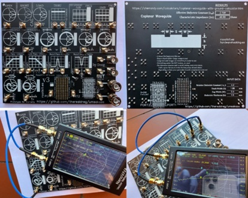](https://www.elecrow.com/umsakazo-rf-training-board-for-nanovna.html)

If you register on Elecrow through the first link before buying the product (the second link), you'll help me support and maintain this project even more:
- [https://www.elecrow.com/referral-program/OTI1MDhqMnQ/](https://www.elecrow.com/referral-program/OTI1MDhqMnQ/)
- [https://www.elecrow.com/umsakazo-rf-training-board-for-nanovna.html](https://www.elecrow.com/umsakazo-rf-training-board-for-nanovna.html)

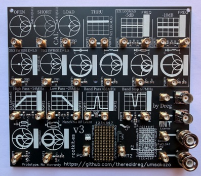

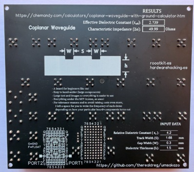

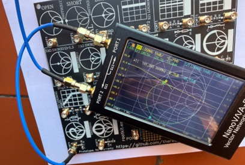

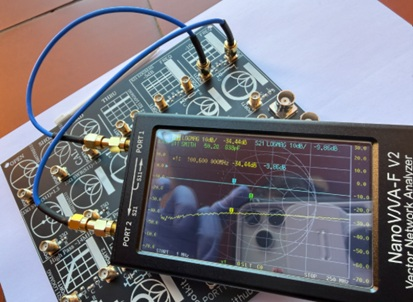

This introductory video demo shows how to use the umsakazo board:

[https://youtu.be/kYVsM9EE5ec 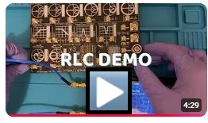](https://youtu.be/kYVsM9EE5ec)

# Frequency range for each demo

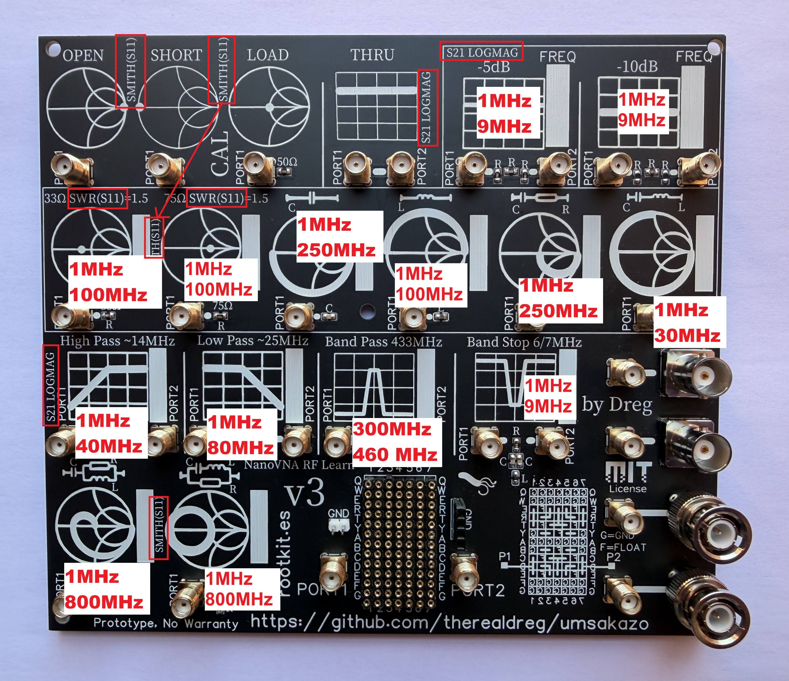

# Story behind the project

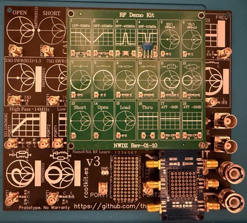

The famous green "RF Demo Kit for NANOVNA" board, with its tiny snap-on U.FL connectors, was a pain to use with students in my hardware hacking bootcamps. On top of that, you can't connect and disconnect it many times without breaking something. That's why I designed this demo board with SMA connectors.

It's sturdier and easier to use and solder. It lets you experiment with different components and configurations, to learn about RF and how to use a NanoVNA.

I also took the idea of the famous "NanoVNA Testboard Kit" for the board's Testboard, but with a larger prototyping area that fits more components.

I built everything pretty much from scratch in my own way. I hope you like the idea.

The board comes fully assembled, with high-quality surface-mount (SMD) components of size 0805: C0G capacitors, thin-film resistors and so on, without exceeding the target price.

It's larger and has more components, including more expensive ones and through-hole parts, and it needs more soldering. So it naturally costs more.

If you want a cheap SMA alternative, check this project by IMSAI Guy, but you have to transplant components from the original U.FL board: https://www.youtube.com/watch?v=2W0pjMk56rA

Btw, IMSAI Guy's board has better RF performance. But I designed umsakazo for learning and experimenting, not for precision measurements, so I put ease of use and component accessibility ahead of high-frequency performance.

## Why umsakazo name?

umsakazo means radio in Zulu (South Africa).

# Getting started with NanoVNA and umsakazo

Learn how to use a NanoVNA, and some electronics, from scratch with umsakazo. This tutorial teaches the basics of the NanoVNA, S-parameters (scattering parameters: how a circuit reflects and passes a signal) and simple measurements with the board.

The tutorial is written for the NanoVNA-F V2 (AURSINC / Seesii), a vector network analyzer (VNA) that covers 50 kHz to 3 GHz.

# Basics

Passive components (resistors, capacitors and inductors) don't behave the same way at every frequency. An ideal resistor is the calm one. Its impedance (how much it opposes a signal) stays flat no matter how fast the signal changes. Capacitors and inductors are mirror images of each other. Push the frequency up and a capacitor's impedance drops: it lets fast signals through. An inductor's impedance climbs instead: it pushes back against fast signals. That's the clean textbook picture.

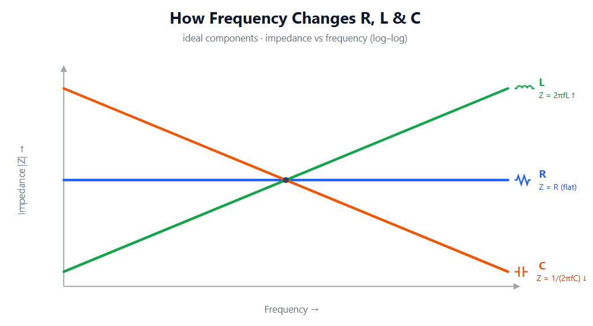

But no real part is perfect. Every lead, pad and winding (a coil of wire) hides a tiny bit of extra inductance and capacitance: the part's parasitics. At a certain frequency, called the self-resonant frequency (SRF), the parasitics take over and the part flips character. Above its SRF a capacitor starts behaving like an inductor, and an inductor starts behaving like a capacitor. That is why through-hole parts struggle at high frequencies. Their long leads and bulkier construction add more parasitics and drag the SRF down. So they flip at a far lower frequency than tiny SMD parts with their short leads. When you need clean high-frequency behavior, short leads and small packages (small bodies) win.

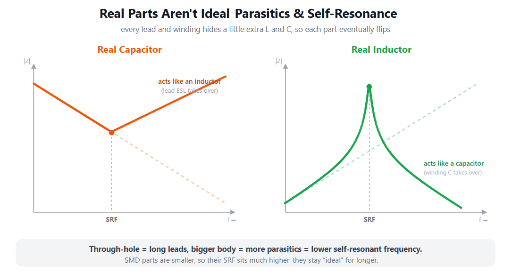

A resistor is the simplest part, but it has parasitics too. It stays a clean, flat "R" only up to a corner frequency. Above that, its value and build decide what it becomes. Low-value resistors and wirewound ones have enough lead and winding inductance that their impedance starts to rise: they begin acting like inductors. High-value resistors do the opposite, thin-film ones (a thin, even layer of metal) included. At high frequency the tiny capacitance across their body lets the signal go around them, so their impedance falls and they start acting like capacitors. As with capacitors and inductors, long leads and bulky construction push that corner down, while small SMD parts keep the flat region the widest.

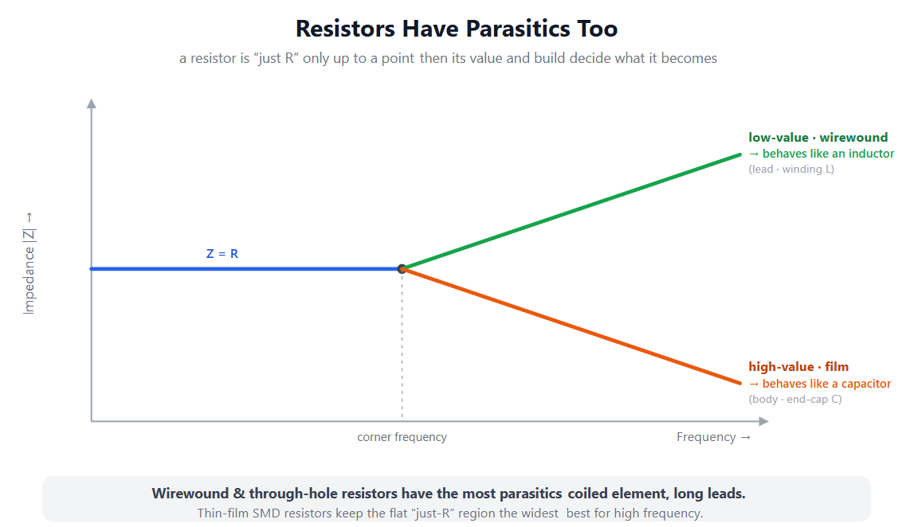

Every real capacitor also carries a tiny inductance in series with its capacitance (C): its equivalent series inductance (ESL). That is why its impedance dips at the SRF. Below the SRF the capacitance dominates and the impedance falls. Right at the SRF the reactance of the capacitance (its part of the impedance) and that of the ESL are equal and opposite, so they cancel. What is left is the part's ESR (its equivalent series resistance). The impedance bottoms out at that value and doesn't drop to zero, so a lower ESR means a deeper, sharper dip. Above the SRF the ESL takes over: the impedance climbs back up and the "capacitor" behaves like an inductor. The SRF is the frequency where C and the ESL ring together, or resonate: f = 1/(2π√(ESL·C)).

A real inductor is also more than its inductance (L). Its turns of wire sit next to each other and store charge, so the part has a parasitic winding capacitance in parallel with the coil. The two resonate at the inductor's own SRF. The same 1/(2π√(LC)) relation sets it, but now L is the coil's inductance and C is that winding capacitance. This one is a parallel resonance, so the impedance peaks instead of dipping. Below the SRF the part behaves as an inductor and its impedance rises. Right at the SRF the impedance shoots up to a tall peak. Only the inductor's losses limit that peak: the higher its Q (its quality factor, high when the losses are low), the taller and sharper the peak. Above the SRF the capacitance wins: the impedance falls again and the "inductor" starts behaving like a capacitor.

A resistor can go further than a simple bend at its corner frequency, too. If it has both noticeable lead inductance and body capacitance, those two parasitics form a tiny resonant circuit of their own. The resistor's impedance can then show a genuine resonance, a dip or a peak, instead of just curving up or down.

A real circuit is full of parasitic Ls and Cs, and every L-C pair rings at its own frequency. So the impedance of a real board isn't one clean curve with a single SRF. It zig-zags through many resonances at many different frequencies. A pair that resonates in series makes a sharp dip, and a pair that resonates in parallel makes a tall peak, called an anti-resonance. Taming that messy impedance curve is the job when you design a power-distribution network (PDN), the copper and capacitors that feed power to a board's chips.

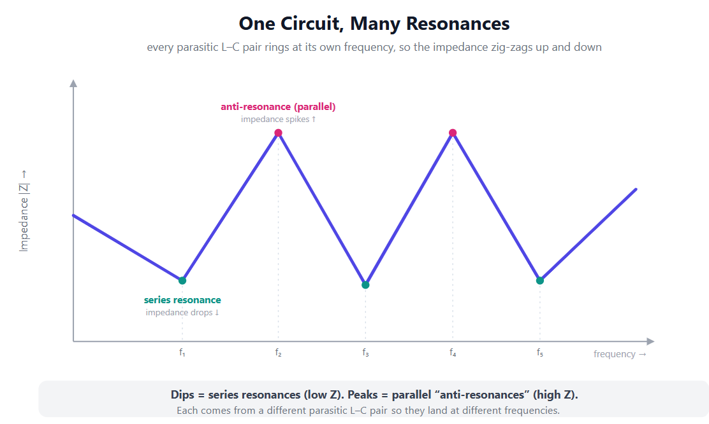

So far we've only talked about how much a part impedes a signal: its impedance magnitude. But impedance has a second half: phase, the timing shift the part puts between voltage and current. A resistor keeps them in step (0°): voltage and current peak together. An inductor makes voltage lead current by 90°, and a capacitor makes voltage lag by 90°: opposites again, just like with magnitude. The old mnemonic is ELI the ICE man: in an inductor (L) voltage (E) leads current (I), and in a capacitor (C) current (I) leads voltage (E).

At 90°, voltage and current sit a quarter of a cycle apart, so an ideal inductor or capacitor stores energy and hands it straight back instead of burning it. That leaves only the resistor, at 0°, to dissipate power (turn it into heat).

Phase is also the cleanest way to catch a part flipping character. Right at its SRF the phase swings through 0° and changes sign (a lag becomes a lead, or the reverse). So a "capacitor" that has gone inductive shows it in its timing as well as in its magnitude.

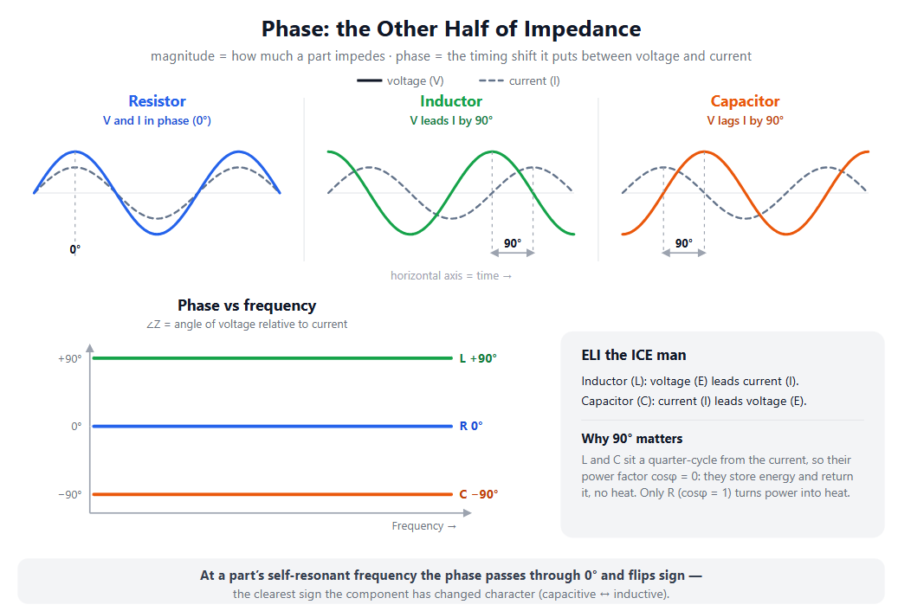

There are two very different ways to measure magnitude and phase. The hands-on one is an oscilloscope (a scope for short). You put a small resistor of known value, called a shunt, in series with the circuit and watch the voltage across the shunt. By Ohm's law that voltage is the current, just scaled. With the circuit's voltage on a second channel, you see both waveforms and read the phase straight off the screen. If you'd rather not break the circuit, a clamp-on current probe does the same job: it feeds the current waveform straight into the scope. A transformer-type probe works for AC, and a Hall-effect one also reads DC. Either way you stay in the time domain: you watch voltage and current directly, as they change over time.

A vector network analyzer such as a NanoVNA works nothing like that, and it never measures current. It sends a wave into the part, one frequency after another (a sweep). It measures that incident wave and the reflected wave that bounces back, and reports their ratio, reflected divided by incident, as S11. S11 is a complex number, with a magnitude and a phase. Taking 50 Ω as its reference impedance (Z₀), the VNA then computes the impedance from that reflection: Z = Z₀·(1 + S11)/(1 - S11). The current is only inferred.

The VNA captures the phase of the reflection directly. From the reflection it can also display the impedance phase, the same voltage-versus-current angle you'd read on the scope, but that too is calculated, never measured. That is also why a VNA must be calibrated with three known standards before any of it means anything: an open (nothing connected), a short (the signal tied to ground) and a load (a 50 Ω resistor). The calibration tells the instrument where "incident" ends and "reflected" begins at the tip of your cable.

S11 is only half of what a NanoVNA can do. It is a reflection measurement: the signal goes out of the VNA's port 1, and you look at what bounces back into port 1. S21 is a transmission measurement: the signal still goes out of port 1, but now you read what arrives at port 2. That is the far side of whatever you connected between the two ports: the device under test (DUT). So S11 answers "how much of my signal got rejected at the door?", while S21 answers "how much of it made it through to the other end, and with what phase?".

That makes S21 the natural way to measure anything a signal passes through: filters, cables, amplifiers, attenuators (parts that weaken a signal by a set amount). A low-pass filter, for instance, passes low frequencies and blocks high ones. In its passband, the frequencies it lets through, its S21 is near 0 dB (decibels): everything passes. Where it starts blocking, S21 drops steeply into deep negative dB: the more negative, the less gets through.

Like S11, S21 is a complex number: its magnitude says how much made it through, and its phase how much the part delayed it. And like S11, it means nothing without calibration. Now the path from one port to the other matters too, so the NanoVNA's transmission calibration adds a thru step to the open, short and load.

A NanoVNA drives only port 1: it sends the signal out of its PORT1 connector, never out of PORT2. The figure below names each wave from the DUT's side: a goes into the DUT and b comes out of it. It says to drive port 2 for S22 and S12, the same two measurements from the other side of the DUT. That is what a full two-port VNA does. With a NanoVNA you turn the DUT around instead.

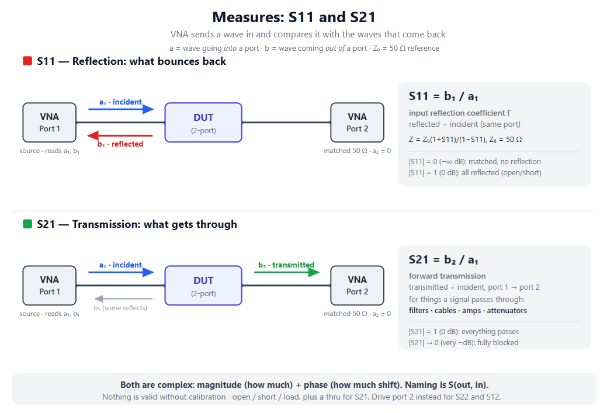

Everything above is an AC thing: it only happens because the signal keeps changing. In DC, frequency is zero, so there's nothing to react to. A capacitor charges once and then blocks DC like an open circuit. An inductor settles into a plain wire: a short with only its winding resistance left. A resistor doesn't care (R is R in DC and AC alike). The parasitics vanish too: a stray inductance becomes just wire, and a stray capacitance just an open gap.

DC is not harmless for every part, though. Ceramic capacitors come in two families. Class 1 (in practice C0G, also called NP0) barely changes with voltage, temperature or age, but it only reaches small values. Class 2 (X5R, X7R and the like) packs far more capacitance into the same package and pays for it. A DC voltage across it lowers the capacitance it shows to the AC signal riding on top, and lowers it further as that voltage rises. Used near its rated voltage, such a capacitor can be left with less than half of its nominal value. Its capacitance also moves with temperature (an X7R may be up to 15% off across its temperature range) and drops a little as the part ages.

The package counts in the DC loss too. A ceramic capacitor is a stack of thin ceramic layers between metal plates. For the same value, a smaller package needs thinner layers (and often a ceramic that loses more capacitance under voltage). So the same voltage makes a stronger electric field in them, and the loss is larger. In one published comparison of 4.7 µF X7R parts at 12 V, an 0805 (2 by 1.25 mm) kept about a third of its value and a 1210 (3.2 by 2.5 mm) almost nine tenths.

A NanoVNA or a handheld LCR meter (it reads L, C and R directly) measures with a small AC signal, not at the DC voltage of your circuit. So neither sees this loss. Makers call it the DC bias characteristic. Look up the DC bias curve of the exact part, in its datasheet or in the maker's online tool, to see about how much is left at your working voltage. The capacitors on this board are C0G, so they have no such loss.

Resistors have a DC effect of their own: extra noise, a small random voltage on top of whatever they carry. Every resistor makes thermal noise, with DC or without: a noise voltage that depends only on its resistance and its temperature and is the same for any kind of resistor. A resistor with a DC voltage across it adds a second noise on top, called excess noise or current noise. It grows with that voltage and is strongest at low frequencies: its power per hertz goes as 1/f (halve the frequency and it doubles). So it matters in audio and in slow, precise measurements much more than at RF.

With excess noise the kind of resistor counts. A thick-film resistor is a fired paste of conductive grains in glass. The current has to find its way from grain to grain, and this kind is among the noisiest. A thin-film resistor is an even layer of metal and makes far less. Within one kind and one value, a bigger package makes less of it than a smaller one.

The resistors on this board are thin film. The NanoVNA measures with a small RF signal and could not see noise this small anyway, so their low noise makes no difference to these demos. What thin film gives here is the wide flat region of the resistor figure above.

Don't trust a NanoVNA with everything. It always measures relative to 50 Ω, and it is happiest when whatever sits at the end of the cable is somewhere near 50 Ω. With a very high impedance (a tiny capacitor, a high-value resistor) or a very low one (a big capacitor, a tiny inductor, almost a short), the measurement crowds into the outer edge of the Smith chart. That is the round chart on which the NanoVNA draws S11. At its edge nearly all the signal reflects and the readings turn twitchy: a tiny error in what the instrument measures becomes a huge error in the impedance it reports. As a rough guide, the zone you can trust is about 5 Ω to 500 Ω (roughly a factor of ten either side of 50 Ω). Take anything well outside it with a pinch of salt.

Calibration only fixes the reference point right at the connector. So every adapter, clip lead and bit of breadboard beyond it adds stray inductance and capacitance that the NanoVNA cheerfully blames on your component. That gets worse the further you are from 50 Ω and the higher you go in frequency.

You can still point a NanoVNA at a 75 Ω cable or an antenna, but its SWR (standing wave ratio) and Smith chart are drawn for a 50 Ω world. To change that, renormalize the saved S-parameters in software: scikit-rf can recompute them for another reference impedance. Or add a matching pad (a resistor network between the two impedances) and calibrate after it with 75 Ω standards.

A NanoVNA is also a budget tool. Its dynamic range (the span from the strongest to the weakest signal it can measure) is modest, so it cannot see the very deep notches (dips) of a high-rejection filter. Its accuracy tails off at the very top of its frequency range.

For an exact component value, an LCR meter or an impedance analyzer is the better instrument. For very high or very low impedances, the shunt-and-scope trick from earlier often wins at low frequency. At RF, the series and shunt S21 measurements described later often do. In series the part sits in the signal path, and in shunt it goes from that path to ground. The NanoVNA shines where it was meant to: on things of 50 Ω or so, like antennas, feedlines (the cables that feed them), filters and matching networks.

# The NanoVNA: the perfect tool for making a fool of yourself in a very sophisticated way

The NanoVNA does not lie. After a good calibration it tells you the precise truth about whatever sits at the end of the cable. The trap is that what sits there is almost never just the component you think you are measuring. It is also almost never in the situation where it will be used. So you can get a gorgeous, authoritative-looking Smith chart for something that has very little to do with your real circuit. That misplaced confidence is what lets you be wrong in a very sophisticated way.

Take a component soldered onto an SMA connector, or plugged into the Testboard (umsakazo's prototyping area with header pins). What you measure is not "the resistor" or "the capacitor": it is that part plus its leads, the pads, the connector and the little patch of ground around it. At a few MHz those extras are invisible and the reading is basically the part. At higher frequencies they start to matter, and you are measuring the part welded to this particular fixture (the hardware that holds it).

It gets worse if that connector or adapter is cheap and no-name, with no datasheet: an unknown, badly controlled impedance right in the signal path. It adds its own parasitics and its own mismatch (a jump in impedance that reflects part of the signal) on top of everything else. So now you are not even sure how much of the mess is your component and how much is the random SMA you grabbed from the drawer.

"Fine," you say, "I will de-embed it and recover the bare component." De-embedding removes the fixture's effect from the measurement by calculation. Even then there is a deeper trap. Drop that same bare part into a different final PCB (printed circuit board), with copper traces of different lengths, different neighbors and a different ground plane (the board's large copper area connected to ground). There the part will show a different effective inductance or capacitance and a different self-resonant frequency. RF parts do not carry a single true value around in their pocket; they have a value in a context.

Measuring a part on the Testboard to predict how it will behave somewhere else is a bit like weighing yourself on the Moon to learn your weight on Earth. The scale is honest, but the number answers a different question. The Testboard is good for seeing the effect and building intuition, but it does not give you numbers you can paste into a different design. For an exact part value, the right tool is an LCR meter or an impedance analyzer. To know how the part behaves in the product, you have to measure it in the product, or in a faithful copy of it.

Antennas are the same trap, only bigger and more spectacular. A lot of the small antennas you will meet are not designed to work on their own at all: the device they plug into is part of the antenna. A quarter-wave monopole, a rod or wire about a quarter of a wavelength long, is only half an antenna. It needs a ground plane to act as its other half, or a counterpoise (usually one or more wires that do the same job). The PCB antennas and chip antennas inside real products (inverted-F, meandered monopoles and friends) are tuned in the datasheet for a specific ground-plane size and a specific keep-out area (the copper-free zone around the antenna). They go straight out of tune the moment that ground is different.

The measurement itself joins in. Feed an antenna from a coaxial cable (coax), and the outside of the cable shield can carry current and radiate unless a common-mode choke, described later, holds that current back. The radiating cable is now part of the antenna too, while your hand and the bench cheerfully detune the rest. Measure an antenna like this on its own and you get a precise S11 and a clean SWR curve for a system that will never exist in your product.

The conclusion can even come out backwards. An antenna that looks "perfect" alone on the bench can be useless once it sits in the enclosure on the real board. One that looks "broken" on its own can be exactly right as part of the finished product. So the honest way to measure an antenna is in its real situation: with the real ground plane or enclosure, a proper common-mode choke on the feed cable, and a setup that looks like the product instead of a bench experiment.

None of this makes the NanoVNA useless. It means the skill is not reading the screen: it is making sure that the thing at the end of the cable is the thing you care about. Get that wrong and the NanoVNA will happily help you be confidently, beautifully, scientifically wrong. Get it right and it is one of the best learning and debugging tools you can put on a bench.


# Even the amount of solder matters

One more thing is easy to overlook: the solder itself. What the NanoVNA sees depends on whether a joint is electrically sound, and also on how much solder you put on it. The amount changes the reading in two different ways.

First, solder is metal, so a big, blobby joint adds more conductor next to the pads, the pins and the nearby ground. More metal means more surface facing everything around it, and more surface facing a nearby conductor means more parasitic capacitance. So a fat blob adds a little capacitance to whatever you are measuring. That slightly shifts its effective value and pulls its self-resonant frequency down. On a capacitor you add to its capacitance, and on anything else you contaminate the value. Of the two solder effects, this capacitive one is the gentler. It shows up lower in frequency than the other, but it is small, and it depends heavily on how close the blob sits to ground or to the other terminal.

Second, and less obvious: solder is a much worse conductor than copper, roughly eight times worse. Lead-free tin-silver-copper is a little under that, and eutectic tin-lead (the ratio with the lowest melting point) is a little over. At DC this does not matter, because the current flows through the whole cross-section and most of that path is copper anyway. A small blob of solder has a tiny DC resistance.

At RF the current does not use the whole conductor. The skin effect squeezes it into a thin surface layer, only a few micrometers deep near the top of our frequency range and some tens of micrometers at lower frequencies. The depth where the current has faded to about a third is called the skin depth. So the RF current rides on the outermost skin of the joint. A layer of another metal on top only really takes over the current once it is a few skin depths thick. Silver plating works because of this, and solder is the reverse: the worse conductor is on top. In solder, one skin depth is around 19 micrometers at 100 MHz and about 6 at 1 GHz. A fat blob (hundreds of micrometers) is many skin depths of the bad conductor, so the RF current flows almost entirely in the solder and never reaches the good copper underneath.

The result is more series resistance at RF, more loss and a lower Q. That resistance is about three times copper's, because surface resistance goes with the square root of resistivity (how poorly a metal conducts). The lower Q shows up as a shallower, more damped notch or a lower, broader resonant peak. But a thin, clean tinning (a coat of solder) of a few micrometers is well under one skin depth up to a few hundred MHz, so the current still mostly sees the copper below it. This second effect grows with frequency, so it stays hidden at a few MHz and becomes more and more visible as you go up.

The nickel in ENIG board finishes (electroless nickel immersion gold, a coating on a board's exposed copper) is a problem of the same family. Nickel is ferromagnetic (magnetic, like iron) and so an even worse RF conductor. But it only really matters in the microwave range and on low-loss board materials. The finish is the least of your worries at the frequencies of this board, and on FR4, where the loss in the board material itself (the dielectric loss) is large anyway. ENIG is fine here.

There is also a third, more mundane reason to be consistent: every hand-soldered joint is slightly different. So to compare two components fairly, use a similar, small amount of solder on both. Otherwise part of the difference you see on screen is the difference in your soldering, not in the parts.

On this kind of board, though, the amount of solder is a second-order or third-order effect, well behind the lead inductance (around 1 nH per millimeter) and the undefined impedance of the header pins. It matters most when everything else is already clean and you push toward the high end of a demo's frequency range. So the rule "use as little solder as possible" is electrical, not a matter of tidiness. Less solder means less added capacitance, less RF loss and more repeatable measurements, even though the solder will never be your main source of error here.

In solder, lead is the metal that drags conductivity down, so lead-free solder comes out slightly ahead on paper. But the difference between alloys is negligible next to the two things that matter here: using as little solder as possible, and making a clean, mechanically sound joint.

A bad joint can wreck a measurement far more than any choice of alloy. A cold or poorly wetted joint sits as a dull, grainy lump instead of flowing into a smooth, slightly concave shape (the fillet). It never forms a proper metallurgical bond with the copper. Hidden underneath are micro-cracks and patchy contact. They mean extra series resistance and inductance that are not even constant: both drift with temperature, with vibration, and every time you flex the board or re-plug a part. That is the worst possible failure for an instrument whose whole job is to measure small differences, because the reading stops being repeatable. Part of what you see moving on screen is now your joint shifting under your hands, and no longer the component. It is even worse on a fixture like the Testboard, where you plug, unplug and prod parts constantly, so a marginal joint fatigues and cracks over time.

A good joint is the opposite. The solder wets both the pad and the lead (it spreads over them and bonds). It pulls itself into a thin, smooth, slightly concave shape, using the least metal that does the job. Heat the pad and the lead, and melt the solder on them rather than on the iron tip. Let the solder flow in by capillary action, use flux for clean wetting, and do not move anything while the solder freezes. Tin-lead joints look shiny when they are good, but lead-free joints are naturally a little duller. So do not read dullness on its own as a bad joint: judge the joint by the wetting and the shape. A joint made this way has low resistance and is stable and repeatable. It beats the fanciest alloy applied badly, every time.

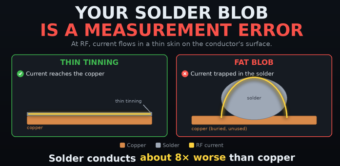

# What happens inside a coax cable

The cable between your NanoVNA and the board is a component too. Take RG-58 as the example: a common 50 Ω coax, the kind sold with BNC connectors. Your multimeter never finds those 50 Ω. With nothing connected to the cable, it reads an open circuit between the center conductor and the shield (the wire in the middle and the braid around its plastic insulation).

## Why a 50 ohm cable is 50 ohm

Connect a 1 V source to one end of the cable. The voltage does not appear along the whole cable at once. In RG-58 it advances as a wave at two thirds of the speed of light: about 20 cm every nanosecond (ns).

While the wave advances, it cannot know what is connected at the far end: nothing has reached that end yet. All it meets is more cable. The center conductor and the shield of each new piece of cable form a small capacitor. The front of the wave has to charge it to 1 V, and that takes current: out on the center conductor and back on the shield. RG-58 has about 100 pF per meter, so every nanosecond the wave charges another 20 pF. Charge is capacitance times voltage, and current is charge per second: 20 pF times 1 V every nanosecond is 20 mA. The cable alone sets this current, by its insulation and by the ratio between the inside diameter of its shield and the diameter of its center conductor.

So a wave of 1 V enters this cable with 20 mA, whatever its length and whatever is at the far end. 1 V divided by 20 mA is 50 Ω. That ratio of voltage to current, in a wave traveling one way, is the characteristic impedance of the cable: the 50 Ω printed on it.

In a 75 Ω cable the center conductor is thinner, with the same shield and insulation. The cable then has about two thirds of the capacitance, so at the same speed the wave takes two thirds of the current: 13.3 mA. 1 V divided by 13.3 mA is 75 Ω.

The front reaches the far end of the 50 Ω cable after about 5 ns for each meter. What is connected there sets its own ratio of voltage to current. A 50 Ω resistor takes exactly the 1 V and 20 mA that arrive, so the wave ends in it and nothing comes back. An open end takes no current and a short holds no voltage. Power needs both, so neither can absorb the wave: it comes back as a reflected wave, like an echo. Any other resistor absorbs part of the wave and sends the rest back. The source knows none of this for the first 10 ns per meter of cable, the time the wave takes to go there and back. Until then it sees 50 Ω.

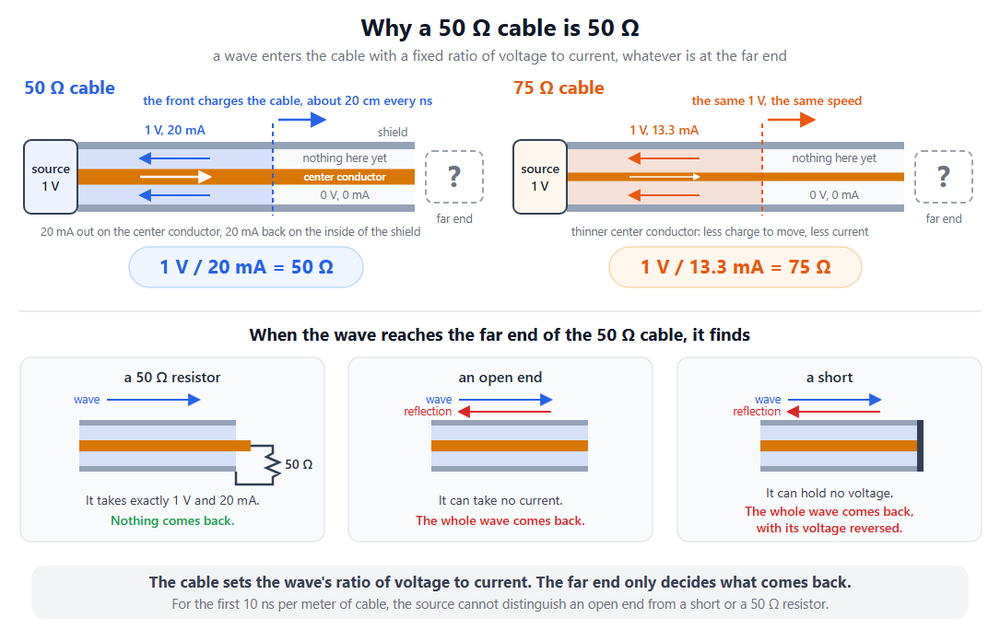

An RF signal never stops changing. So there is always a wave on its way out, and a reflection on its way back unless the far end is 50 Ω. S11 is that reflection divided by the wave the NanoVNA sent. That is why the load of its calibration is a 50 Ω resistor: it reflects nothing.

A multimeter is far too slow for any of this. The reflections have ended long before it shows a reading, and it sees only what is at the far end: here, an open circuit.

The 50 Ω of the cable does not waste power. A resistor turns power into heat. The cable carries it to the far end.

## Where a cable loses signal

A real cable turns a little of the signal into heat on the way, in two places.

One is the copper. At RF the current uses only a thin skin of the metal, the skin effect again. Here it is on the two surfaces that face each other: the outside of the center conductor and the inside of the shield. The two conductors of a meter of RG-58 together have about 0.05 Ω at DC and a few ohms at 1 GHz. The skin gets thinner as the frequency rises, so this loss grows roughly with the square root of the frequency.

The other is the insulation: the dielectric loss. The insulation does not conduct, but it is made of charges: the electrons and nuclei of its molecules. The signal's electric field pulls them a little apart, one way and then the other, on every cycle. Nearly all of that motion follows the field with no delay and costs nothing. A small part lags behind and leaves a little heat on every cycle. More cycles per second leave more heat per second, so this loss grows with the frequency, faster than the loss in the copper.

How much of the motion lags depends on the material, and the number that measures it is the loss tangent. Polyethylene, the insulation of RG-58, has about 0.0003. FR4, the material of this board, has about 0.02, roughly 70 times more.

In RG-58 most of the loss is in the copper, at every frequency up to 3 GHz. A meter of it loses about 0.15 dB at 100 MHz and 0.5 to 0.75 dB at 1 GHz, depending on the cable. A loss of 0.5 dB is about a tenth of the power.

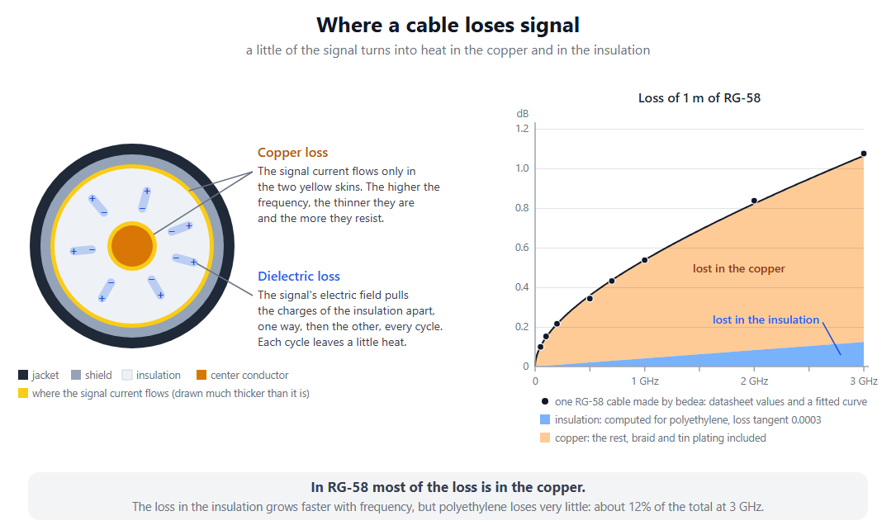

## The current on the outside of the shield

At RF there are always two currents inside the cable: the signal on the center conductor and its return on the inside of the shield, equal and opposite. That is true at every point of the cable, whatever is connected to its ends.

The shield has an outside too. The field of the signal is inside the cable, between the two conductors. An RF current flows in a thin skin under the surface that faces its field, so the return current stays on the inside of the shield. From a few MHz up, that skin is several times thinner than the wires of the braid, and very little of the signal leaks out between them. That leaves the outside of the shield free to carry a current of its own. It acts as a third conductor: a wire that runs along your cable.

The end of the cable is one place where current gets onto the outside. Feed a dipole (an antenna made of two wires in line) directly from a coax: the center conductor goes to one wire and the shield to the other. At the end of the cable the inside of the shield is joined to two things: that wire of the antenna and the outside of the same shield. Its current splits between these two paths, and how much each takes depends on the impedance of both. The part that flows on the outside of the shield is the common-mode current.

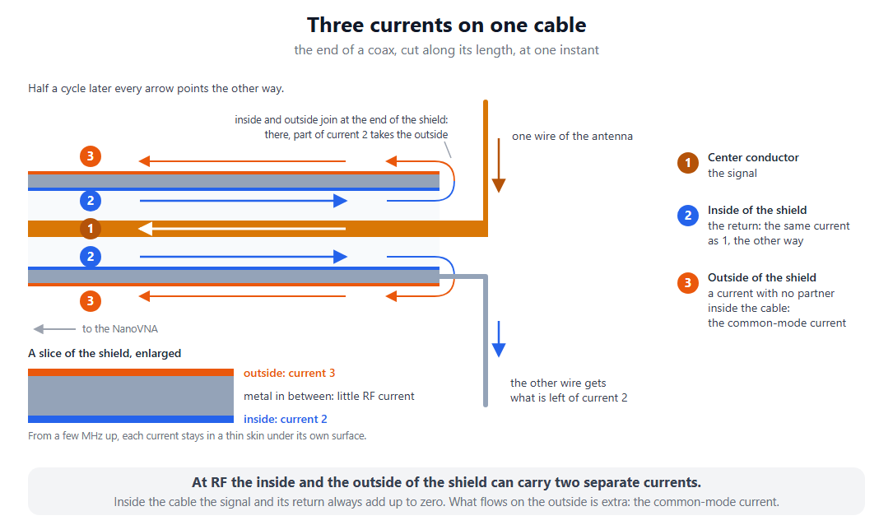

The common-mode current is the net current of the cable: add up the currents of all its conductors at one point, each with its direction. A current probe clamped around the whole cable reads it. The signal and its return cancel, and what is left is the current on the outside of the shield. Like the current in the antenna's own wires, it needs no return wire: the capacitance between the cable and everything around it closes the circuit. It makes the cable radiate and pick up noise, so the cable is now part of the antenna. The NanoVNA's reading changes when you move a hand along the cable.

At RF "the shield is ground" is only half true. Ground is one point, the one taken as zero volts. The shield is a wire that starts there, and a current on its outside puts a voltage along it, as on any wire.

## What a common-mode choke does

A simple common-mode choke for a coax is a ring or a clamp-on sleeve of ferrite (a ceramic that magnetizes easily) with the whole cable through it. Ferrite reacts to the magnetic field that runs through it, and that field is set by the net current through the hole of the ring.

For the signal and its return that net current is zero: they are equal and opposite, so outside the cable their magnetic fields cancel. The ferrite has nothing to act on, and the cable keeps its impedance and its loss.

The current on the outside of the shield has no partner in the cable. Its field does run through the ferrite, which puts an impedance in that current's path: an inductor with losses. One clamp-on sleeve that fits RG-58 adds about 30 to 100 Ω at 10 MHz and about 70 to 300 Ω at 100 MHz, depending on the part.

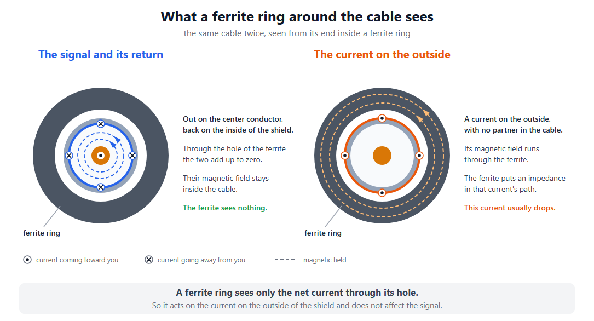

That impedance usually lowers the current and turns part of its energy into heat. How far the current drops depends on the rest of its path: the length of the cable and whatever the NanoVNA is connected to. But many sleeves act more like an inductor than like a resistor at 10 MHz. Such a sleeve can cancel the reactance of the capacitance that closes the circuit. Then the impedance of the path falls and the current rises instead.

The drop also depends on the ferrite material, which works over its own range of frequencies, and on how many times the cable passes through the ring. Two passes through a ring wide enough for them give about four times the impedance of one pass, and three about nine, up to a few tens of MHz. Higher up, the capacitance between the passes takes over, and above a few hundred MHz they give less than a single pass.

Put the choke where the cable leaves the antenna, because the cable between the antenna and the choke is still part of the antenna. If the reading still changes when you move a hand along the cable near the NanoVNA, the choke was not enough: add more sleeves in a row, since their impedances add up.

# Let's start

I assume your NanoVNA has the latest firmware and its factory default settings.

Connect the NanoVNA to a computer and reset it from Tera Term or any other serial terminal:

```
ch> clearconfig 1234
Config and all cal data cleared.
ch> saveconfig
Config saved.
ch> reset
Performing reset
```

Now disconnect the NanoVNA from the computer and power it off, then power it on again to start with a clean slate. Repeat the power-off and power-on two times to make sure all settings are reset.

# Your first demo: SMITH S11 - RC Series


First, press the right side of the screen to open the NanoVNA's main menu.

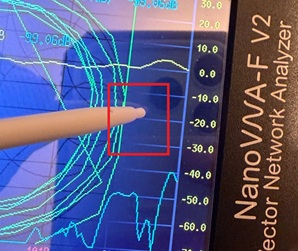

Select "STIMULUS" to configure the frequency range.

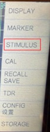

Select "START" and then "STOP", two entries of this menu, to set the frequency range of your measurements: 1 MHz to 250 MHz for the RC Series demo. Each entry opens a keypad: type the number, then press "M" (MHz) and "Ok".

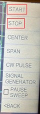

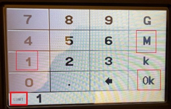

After you press "Ok", press the right side of the screen to open the menu again, then select "STOP" to set the stop frequency.

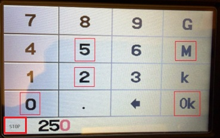

Press the right side of the screen to open the menu.


Select "BACK" to return to the main menu.

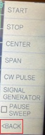

Select "CAL" to open the calibration menu.

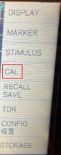

Select "RESET" to clear any previous calibration data: for accurate measurements, start with a clean slate.

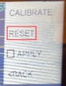

Select "CALIBRATE" to start the calibration.

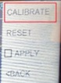

Connect PORT1 to the open calibration standard on the umsakazo board. Then select "OPEN" on the NanoVNA's screen to run the open step of the calibration.

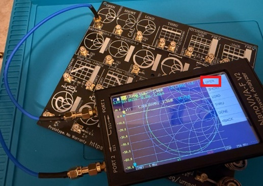

Connect PORT1 to the short standard, then select "SHORT" to run the short step.

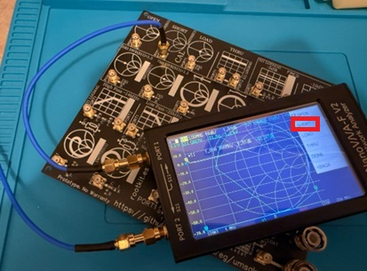

Connect PORT1 to the load standard, then select "LOAD" to run the load step.

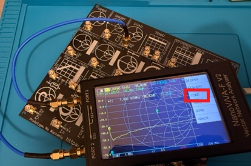

Connect PORT1 (left) and PORT2 (right) to the thru standard, then select "THRU" to run the thru step.

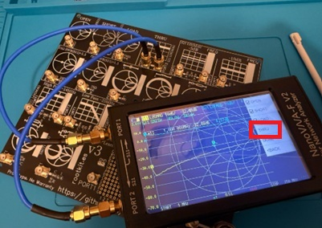

Select "DONE" to finish the calibration.

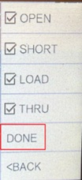

Select "SAVE 0" to save your calibration.


Select "S11 SMITH" in the top-left corner of the screen to display S11 on the Smith chart, where each point stands for an impedance. The green S11 rectangle should be selected.

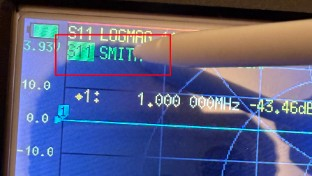

Connect PORT1 to the RC Series demo on the umsakazo board. You should see its S11 response on the Smith chart.

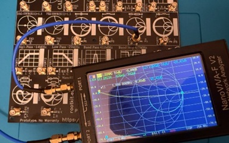

The impedance of an RC series circuit (a resistor and a capacitor in series) changes with frequency. At low frequencies the capacitor acts as an open circuit, which is the right edge of the Smith chart. As the frequency increases, the capacitor's reactance decreases, so current flows more easily and the impedance moves toward the center of the chart, which is 50 Ω. Because the 50 Ω resistor stays roughly constant while that reactance decreases, the impedance traces a semicircle from the open-circuit point toward the point at about 50 Ω.

The resistance is not always exactly 50 Ω, because the components and the PCB design introduce variations, but you should see the general behavior of the RC series circuit on the Smith chart.

Tap marker 1, which shows the measurement at one frequency, to select it. Then drag it with the stylus (or step it with the UP and DOWN buttons) along the trace, the line on the Smith chart, and watch how S11 changes with frequency.

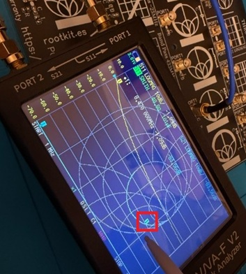

Every time you change the frequency range, recalibrate your NanoVNA (or recall a calibration saved for that range) to get accurate results. If you do not, inside the old range the NanoVNA only interpolates the stored calibration: it estimates the values between the stored points, which is less accurate. Outside the old range the calibration is not valid. Calibration compensates for the losses and characteristics of your measurement system, so your results are as precise as the PCB design and the components allow.

# Your second demo: SWR S11 - 33 ohm

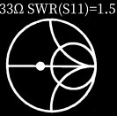

Set the new frequency range, 1 MHz to 100 MHz, as in the first demo, then recalibrate your NanoVNA to get accurate measurements of the 33 Ω demo. Follow the same calibration steps as before: "RESET", "CALIBRATE", "OPEN", "SHORT", "LOAD", "THRU", "DONE" and "SAVE 0". You can skip "THRU" here: this demo only uses S11.

Select "DISPLAY" from the main menu to open the display menu.

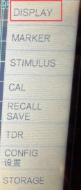

Connect PORT1 to the 33 Ω demo on the umsakazo board. You should see its S11 response on the screen.

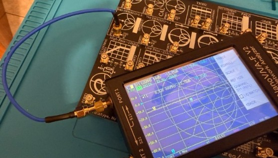

Select "TRACE" from the display menu to open the trace menu.

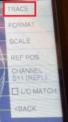

Select "TRACE 3" (the fourth trace: they are numbered from 0) to turn it on and make it the active trace.

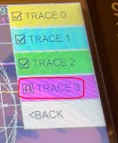

Select "BACK" to return to the display menu, then "FORMAT" to change the display format of that trace.

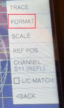

Select "SWR" to display S11 as a standing wave ratio (SWR), which tells how well the load, the circuit on PORT1, matches 50 Ω.

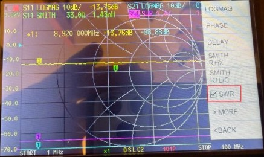

Select "BACK", then make sure "CHANNEL" reads "S11 (REFL)", so that the SWR trace shows S11. If "CHANNEL" reads "S21 (THRU)", change it.

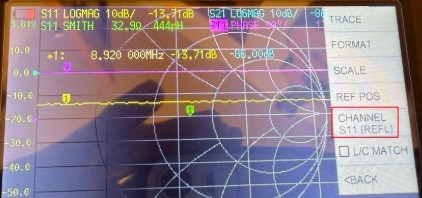

You should now see the SWR of the 33 Ω demo on the screen. The trace is a flat line at about 1.5:1 (the screen reads 1.52). It is flat because the mismatch between a 33 Ω resistor and the 50 Ω reference impedance is the same at every frequency of the sweep. The value is 1.5:1 because the SWR of a resistor below 50 Ω is 50/R (50/33 ≈ 1.5). With a load that changes with frequency, the SWR is higher where the mismatch is greater and approaches 1:1 where the impedance is closer to 50 Ω.

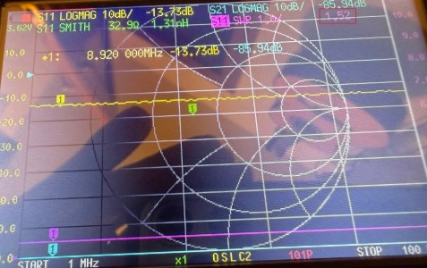

# Your third demo: S21 LOGMAG - Band Stop

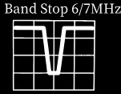

Set the new frequency range, 1 MHz to 9 MHz, as in the first demo, then recalibrate your NanoVNA to get accurate measurements of the Band Stop demo. Follow the same calibration steps as before: "RESET", "CALIBRATE", "OPEN", "SHORT", "LOAD", "THRU", "DONE" and "SAVE 0".

Connect PORT1 to the input (left) and PORT2 to the output (right) of the Band Stop demo on the umsakazo board. You should see the S21 response on the screen.

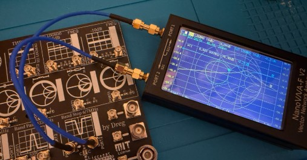

S21 is the transmission coefficient: how much of the signal passes from PORT1 to PORT2. In a band-stop filter, you should see the S21 magnitude drop at the frequencies that the filter is designed to attenuate. The LOGMAG format shows the magnitude of S21 in decibels, which makes the attenuation of the band-stop filter easier to see.

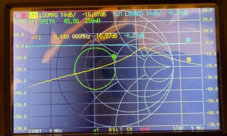

Select the S21 LOGMAG rectangle at the top of the screen, to the right of the S11 one.

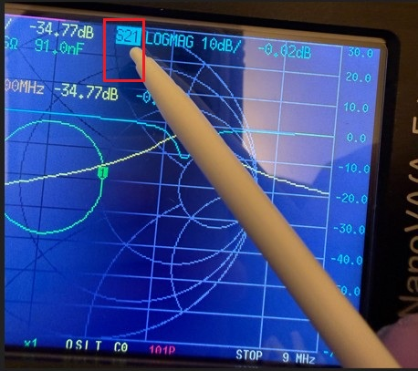

Move marker 1 to analyze the S21 response. You should see the frequency and the magnitude of the point where the marker is, so you can find the center frequency of the band-stop filter and how much it attenuates at that frequency.

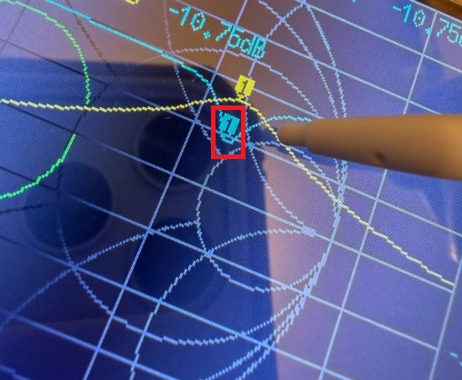

Select "DISPLAY" from the main menu to open the display menu again.


Select "SCALE" to change the scale of the S21 LOGMAG trace.


Type 2 and press "Ok".


You should now see the S21 LOGMAG response of the Band Stop demo with a scale of 2 dB per division (one step of the grid), so the attenuation of the band-stop filter across the frequency range is easier to see.


# Fun with the Testboard

On the Testboard, umsakazo's prototyping area, we can plug in through-hole components and see how they behave across the frequency range we care about.

The first step is to make a small DIY calibration kit (an open, a short, a load and a thru), so that we can calibrate on the Testboard's female header pins. Something like this:


Shopping list for the DIY calibration kit. I use these parts because I had them at home and they fit my purpose best:
- PHP02512E49R9BST5 Vishay Dale (about 5 EUR): Thin Film SMD 2.5watt 49.9ohm .1% 25 PPM 2512
    - datasheet: [stuff/doc/php.pdf](stuff/doc/php.pdf)
    - https://www.digikey.es/es/products/detail/vishay-dale-thin-film/PHP02512E49R9BST5/2508133?srsltid=AfmBOoqPkmv6Nf2_Xzknn7MlR4bIGy4XxmKVGG7BtdBB8IqsZc_BdU-b
    - https://www.mouser.es/ProductDetail/Vishay-Thin-Film/PHP02512E49R9BST5?qs=vSgF7M6Mj64d04hM8gmGaw%3D%3D&srsltid=AfmBOors1frlhNF_xuh7yemOyeOHtxyH1uPmSjlbQh4hqC6fkfiiNOuY
- 2.54 1row male gold Round Hole Pin 1x40P (about 3 EUR)
    - https://es.aliexpress.com/item/4001122376295.html
- 2.54 1row female gold Round Hole Pin 1x40P (about 3 EUR)
    - https://es.aliexpress.com/item/4001122376295.html
- SMA PCB 50 OHM connector male front (about 3 EUR)
    - https://es.aliexpress.com/item/1005004242324252.html?spm=a2g0o.order_list.order_list_main.229.2d6d194dWH1HOn&gatewayAdapt=glo2esp
- SMA PCB 50 OHM connector female front (about 3 EUR)
    - https://es.aliexpress.com/item/1005004242324252.html?spm=a2g0o.order_list.order_list_main.229.2d6d194dWH1HOn&gatewayAdapt=glo2esp

For the thru I used pins and the leads of a through-hole resistor.

The hardest part is soldering the load's resistor to the pins:


- Cut three male pins off the strip.
- Trim the center pin at both ends (it is not used).
- Apply solder to the resistor ends and to the pins, then solder the resistor to the pins, well centered and aligned. The 2512 SMD size is ideal and fits very well.

WARNING: Solder the resistor on the solder-tail side of the pins (the side that normally goes into a PCB). That keeps the other ends, which plug into a female header, completely free.


Before you use a resistor as a calibration load, I recommend soldering it to a male SMA connector and checking its behavior with a properly calibrated NanoVNA:


This is the PHP02512E49R9BST5 resistor from 5 MHz to 100 MHz:


For this measurement you should calibrate right after the connector, so that you measure the resistor alone. Or use electrical delay, a NanoVNA setting that partly compensates for the connector's length. I haven't done either, haha.

If you only have resistors of the smaller 1206 size, fitting one between two pins with another pin in the middle is tricky, but the process is the same. Be careful: the pins can break if you bend them too much. I improvised an extra load with this resistor:

TNPW120649R9BEEA Vishay Dale (about 0.50 EUR): Thin Film SMD 49.9ohms .1% 25ppm 1206

- datasheet: [stuff/doc/tnpw_e3.pdf](stuff/doc/tnpw_e3.pdf)
- https://www.mouser.es/ProductDetail/Vishay/TNPW120649R9BEEA?qs=2reG4Y%252BdyC%252BDRhwn7mYgEw%3D%3D&srsltid=AfmBOoouHOrlxbLSlDdIEXQcODTZPmx6zTsWhHa9K0tSvQCHKqlFmruU
- https://www.digikey.com/en/products/detail/vishay-dale/TNPW120649R9BEEA/1607704

This is the TNPW120649R9BEEA resistor from 5 MHz to 100 MHz, soldered to an SMA connector and measured with a NanoVNA fully calibrated beforehand (open, short and load):


Both resistors read the same on these two screens: about 49 Ω in series with 1.37 nH at the marker, between 94 MHz and 95 MHz, and some 38 dB of return loss (how much weaker the reflection is than the signal sent in). So the plots show the floor of this calibration and fixture (the reflection the setup itself can add), and cannot tell the two parts apart.

Now solder the TNPW120649R9BEEA resistor to the pins:


Way too much solder and a very messy crap job, haha.

Always use high-quality resistors with a datasheet, preferably thin film with a tolerance of 0.1% or better, so their behavior is as predictable as possible. RF-rated ones are even better. Also use as little solder as you can.

Now build a fixture to test parts with male pins: solder three female header pins to a male SMA connector, one outer pin to its center conductor and the other outer pin to its body (ground). Cut the center pin of the three, so that it is not soldered to anything.


The fixture in use, with the 50 Ω load of the DIY calibration kit plugged in:


The open is simple and crappy: cut three male pins off the strip, trim the center pin at both ends, and cut off the solder-tail side of all three pins. That's it: you now have a crap open.


For the short, do the same as for the open, but solder the two outer pins together. The center pin is cut, so solder touching it does no harm.


For the thru, cut 7 male pins off the strip, trim the five middle pins short at both ends, and solder a resistor lead between the first and last pin. A (crap) example:


And that's it: we now have our DIY-CRAP calibration kit for the Testboard. Now we can calibrate the NanoVNA there and measure components through the female header pins.

## Our first experiment on the Testboard

Shopping list:
- One 22 Ω through-hole resistor
- One 22 µH through-hole inductor
- One 47 pF through-hole capacitor

Connect the two NanoVNA cables to the Testboard ports.


On the right of the picture, the map printed on the board shows how the pins are connected to each other. In its cells, G marks a ground pin and F marks a floating pin (connected to nothing). A bar joins the pins it touches. The board has two rows called E: one in the upper block, between W and R, and one in the lower block, between D and F.

Now calibrate from 1 MHz to 12 MHz: open, short and load with our DIY-CRAP calibration kit. Connect each one between D1 and F1 (rows D and F of column 1):


For the thru step, insert the thru between D1 and D7:


Leave the thru where it was during calibration. Then connect the three parts in series to ground:

- the capacitor from C1 to Y2
- the inductor from Y3 to E5 (the E row of the upper block, between W and R)
- the resistor from R6 to Q6


The three parts now form a series RLC circuit (resistor, inductor, capacitor) between PORT1 and ground, and the thru still connects PORT1 to PORT2, whose input is itself a 50 Ω load.

If everything is connected correctly, the NanoVNA should show something like this:


The series RLC circuit is a single L-C-R branch, wired as a shunt: it goes from the path between PORT1 and PORT2 to ground. Connected this way, the network behaves as a band-stop (notch) filter. It passes almost everything except a narrow band around its resonant frequency, where it diverts the signal to ground.

### Where the resonant frequency comes from

Resonance happens at the frequency where the reactance of the inductor and the reactance of the capacitor are equal in size and opposite, so they cancel. The series resonance formula gives that frequency:

$$
f_0 = \frac{1}{2\pi\sqrt{LC}}
$$

where:

- $f_0$ is the resonant frequency in hertz
- $L$ is the inductance in henries
- $C$ is the capacitance in farads

At $f_0$ the two reactances cancel and the branch impedance falls to just its series resistance. The branch is a shunt, so that low impedance shorts the signal to ground and creates the notch.

### Nominal vs. measured values

With the nominal values of the parts (the values they are sold as):

- $L = 22\ \mu H = 22 \times 10^{-6}\ H$
- $C = 47\ pF = 47 \times 10^{-12}\ F$

$$
f_0 = \frac{1}{2\pi\sqrt{(22 \times 10^{-6})(47 \times 10^{-12})}} \approx 4.95\ MHz
$$

But the parts are not exactly nominal: on an LCR meter the inductor read 21.2 µH and the capacitor 46 pF. With those measured values:

$$
f_0 = \frac{1}{2\pi\sqrt{(21.2 \times 10^{-6})(46 \times 10^{-12})}} \approx 5.10\ MHz
$$

That is close to where the notch appears on screen: 5.235 MHz, 2.7% higher. The measured values explain about half of the gap between the nominal prediction and the screen, so always measure your parts.

The other half is upward: 5.235 MHz on screen against 5.10 MHz predicted. That direction is a clue, because extra lead inductance or stray capacitance could only push the resonance down. The marker's position is not the cause either: the Smith reading at the marker (2.95 nH left over, see below) puts it within a few kHz of the true resonance, although neighboring points of the sweep are 55 kHz apart.

So in the circuit the product L·C is about 5% smaller than the LCR readings give. One likely cause is the meter's tolerance and zeroing (the correction for what the meter itself adds) on such small values. The other is that the parts' values at 5 MHz differ from what the meter reads at its much lower test frequency.

## Reading the NanoVNA screen

The capture is an S11 and S21 sweep from 1 MHz to 12 MHz with 201 points, after an OSLT calibration (open, short, load, thru). It shows four traces:

- S21 LOGMAG (cyan) is the transmission from PORT1 to PORT2.
- S11 LOGMAG (yellow) is the reflection at PORT1.
- S11 PHASE (magenta) is the phase of that reflection.
- S11 SMITH (green) is the input impedance (what PORT1 sees) on the Smith chart.

The vertical scale is 10 dB per division, with the 0 dB reference line near the top.

### The marker

The marker sits at the resonant frequency and reads:

| Parameter | Value | Meaning |
|---|---|---|
| Frequency | 5.235 MHz | resonance |
| S21 | -4.66 dB | depth of the notch |
| S11 | -8.26 dB | reflection (rises here) |
| Smith | 22.1 Ω, 2.95 nH | input is almost purely resistive |

The 2.95 nH is the reactance left over: only about 0.1 Ω at this frequency, practically zero. It confirms that the reactances of L and C have canceled.

### S21: the transmission notch

Away from resonance the branch has a high impedance, so the signal passes straight through and S21 stays near 0 dB. At resonance the reactances cancel and the branch drops to a low impedance. It then diverts the signal to ground, which makes the notch at 5.235 MHz.

The series resistance of the branch sets the notch depth (-4.66 dB): the lower the resistance, the deeper the notch. A perfect short would give an infinitely deep notch, but the resistor and the inductor's losses keep it finite. The 22 Ω series resistor is there on purpose to raise the branch impedance, so this notch is relatively shallow. Without the resistor, only the losses of the inductor and the capacitor are left, and the notch gets deeper.

Suppose the branch were only the 22 Ω resistor. A 22 Ω shunt (Z) in a 50 Ω system (Z0) gives S21 = 2Z/(2Z + Z0) ≈ -6.6 dB and S11 ≈ -5.5 dB. The screen shows a shallower notch (-4.66 dB) and a weaker reflection (-8.26 dB instead of -5.5 dB). Both differences point to the same cause: at resonance the branch is around 35 to 40 Ω, not 22 Ω.

The extra 13 to 18 Ω is mostly the ESR of the inductor (equivalent series resistance), plus the plug-in contacts. The inductor's reactance at 5.2 MHz is about 700 Ω. Divided by that ESR, it gives a Q of roughly 40 to 55. That is a normal figure for a small general-purpose choke (a kind of inductor). The gap between the textbook notch and the measured one is not an error to apologize for: it is the inductor's Q, measured for free.

### S11: why reflection *increases* at resonance

Off resonance the branch has a high impedance, so PORT1 sees the 50 Ω of PORT2 and S11 is low (a good match). At resonance the branch drops to its lowest impedance and pulls the input impedance down. The match gets worse and S11 rises to -8.26 dB.

Be careful with the 22.1 Ω on the Smith chart, because that number is not the branch. PORT1 does not see the branch alone: through the thru it also sees the 50 Ω of PORT2. So the input impedance is the branch in parallel with 50 Ω (Zin = Zbranch·50 / (Zbranch + 50)).

Working back from the measured 22.1 Ω, the branch is about 40 Ω. The measured S21 of -4.66 dB independently points to roughly 35 Ω. So at resonance the branch is the 22 Ω resistor plus about 13 to 18 Ω of inductor ESR and contact resistance. It is pure coincidence that the 22.1 Ω on the screen is so close to the 22 Ω of the resistor. That kind of coincidence fools you into believing you measured the resistor directly.

At the notch, transmission drops and reflection rises, but they do not add up to all the power that PORT1 sends in. That is because this notch is lossy (absorptive): a real 22 Ω resistor sits in the branch. The power that no longer reaches PORT2 is split: part is reflected back to PORT1 (S11) and the rest turns into heat in the resistor, the inductor and the contacts.

You can check it with the marker values: |S21|² ≈ 10^(-4.66/10) ≈ 0.34 (≈34% transmitted) and |S11|² ≈ 10^(-8.26/10) ≈ 0.15 (≈15% reflected). So roughly 51% of the power is absorbed, not reflected. Only a lossless network (no resistor) reflects everything it does not transmit.

### The Smith chart: what the green loop means

The Smith chart plots each impedance as its reflection coefficient (the S11 it gives):

- The center is 50 Ω, a perfect match (zero reflection).
- The right edge is an open circuit and the left edge a short circuit.
- The upper half is inductive and the lower half capacitive.

The green trace is the path of the input impedance as the frequency sweeps:

1. At both ends of the sweep the branch has a high impedance, so the input impedance is about 50 Ω and the trace sits near the center.
2. As the sweep approaches resonance, the branch pulls the input impedance down and adds reactance, which moves the trace outward in a circle.
3. The loop crosses the real (horizontal) axis at the marker, where the impedance is purely resistive (22.1 Ω): exactly the resonant point.

The loop is a circle because the Smith chart plots reflection, not impedance. Over the sweep the branch keeps the same resistance while its reactance goes from capacitive through zero to inductive. On a plot of reactance against resistance (the impedance plane), that is a straight vertical line. The Smith chart places an impedance Z at Γ = (Z - 50)/(Z + 50), its reflection coefficient. This formula is a bilinear (Möbius) map, and such maps turn straight lines into circles (a line is a circle of infinite radius).

To be exact, the chart plots the reflection of the input impedance, which is the branch in parallel with the 50 Ω of PORT2, not the branch alone. The parallel combination is also a Möbius map of the branch impedance, and two Möbius maps in a row make another Möbius map. So the vertical line of the branch still lands on the chart as a circle.

A closed loop is the sign of a single resonance: the reactance crosses zero only once, at resonance. The loop shrinks toward the center as the series resistance grows: the same loss that makes the notch shallower.

### S11 phase

The magenta phase trace changes fast through resonance. At the marker it reads 179.72°, right at the ±180° wrap, where the trace jumps between the two ends of the phase range (they are the same angle). That fits the input being purely resistive and below 50 Ω there: a resistance below 50 Ω gives a negative reflection coefficient, and a negative number has a phase of 180°. A fast change of phase across a narrow band is another classic sign of a resonance.

## Summary

| | Off resonance | At resonance (~5.2 MHz) |
|---|---|---|
| L-C-R branch | high impedance | low impedance (about its series resistance) |
| S21 (transmission) | ~0 dB (the signal passes) | notch (-4.66 dB) |
| S11 (reflection) | low (matched) | rises to -8.26 dB |
| Smith trace | near the center (~50 Ω) | swings out and crosses the real axis at 22.1 Ω |

The measured notch at 5.235 MHz is within 3% of the resonant frequency predicted from the measured component values, which confirms both the theory and the build.

### A reality check: why this is "playing", not metrology

This Testboard setup is a toy for teaching and experimenting, not a precision measurement system. That is fine, as long as you understand why.

Everything here works well at low frequencies (a few MHz), but becomes questionable as the frequency rises, for two separate reasons.

First, the through-hole parts and the pins are not ideal components. A real inductor, capacitor or resistor behaves like the ideal part only at low frequencies. As the frequency goes up, the long leads of a through-hole part and the header pins start to act as small extra inductors, and the gaps between them act as small extra capacitors. These unwanted parasitics are a few nanohenries to a few tens of nanohenries, and a picofarad or two. Compared with 50 Ω, you never notice them at 1 MHz. (A couple of picofarads beside a small capacitor is still a few percent of its value, at any frequency.) But the effect of the parasitics grows with frequency, and eventually it competes with the component you are trying to measure. A breadboard-style layout with springy contacts makes this worse: every contact adds a little resistance and inductance, and both change slightly every time you re-plug the part. So at high frequency you measure your component plus the whole messy fixture around it.

Second, a calibration kit defines where "perfect" is, and ours is crap. To calibrate, the NanoVNA measures three known standards (open, short, load). That lets it mathematically subtract the cables and fixture up to the pins, and place its reference plane (the point where its measurement begins) there. But the math is only as good as those standards. A commercial calibration kit has standards machined to known, characterized (measured) values. Our DIY open, short and load are approximate: the load is not exactly 50 Ω, the short has a little inductance, the open has a little capacitance, and none of them are characterized. At low frequency these imperfections are negligible and the calibration is excellent. At high frequency they matter more and more, so the "corrected" result drifts away from the truth.

What we are doing is connecting real parts and watching how they behave, with a calibration good enough to see the important effects (resonance, filtering, impedance) clearly. It is a good way to understand RF. But trust the exact numbers only at the low end of the frequency range, and treat them as approximate as you go higher. For accurate high-frequency measurements you need proper soldered fixtures (no breadboard, no long leads), characterized calibration standards and, ideally, surface-mount parts. Here we are playing, and playing is how you learn.

It is fair to ask what it even means to "calibrate" at an SMA-to-breadboard transition, through female header pins and long through-hole leads. The coax cables and the SMA connectors are a controlled 50 Ω environment, and the board's RF trace (the copper track that carries the signal) is approximately 50 Ω. That 50 Ω world ends the moment the signal leaves the trace and reaches the header pins. A pair of springy pins with a component dangling off them is not a 50 Ω transmission line like the coax, which keeps that impedance along its whole length. The pins have no defined impedance at all, only stray inductance, stray capacitance and contact resistance, and whatever you plug in sets the impedance from there.

To calibrate there, we plug our DIY open, short, load and thru into the Testboard's own pins, right next to the ones the component will use. This tells the NanoVNA to treat that messy junction as its new zero and to subtract everything before it: the cables, the connector and the trace. The catch is that the NanoVNA takes our DIY open, short and load as perfect standards, and they are not. Whatever they really are becomes part of the error of every later reading. Calibration also cancels only what happens up to the pins. It can do nothing about the long leads, the contact resistance and the stray parasitics after them, which now count as part of "your component".

### What is this realistically good for?

The Testboard is a learning tool, not lab metrology (precision measurement), and that is by design. With through-hole parts plugged into header pins and a DIY open, short, load and thru calibration, your readings are good enough to see every effect from the NanoVNA-F V2's lower limit (around 50 kHz) to a few tens of MHz. The values you extract are within about 10% at a few MHz. The reason is physical: component leads add roughly 1 nH of stray inductance per millimeter, the springy header pins have no defined 50 Ω impedance, and DIY calibration standards get worse as the frequency rises. So the parasitics, not the NanoVNA, become the dominant error. Keep your leads short, recalibrate whenever you change the frequency range, and treat the numbers as a way to learn RF, not to certify hardware.

# Frequency range and S-parameters

The NanoVNA is a vector network analyzer that can measure S-parameters across a wide frequency range. S-parameters describe how RF signals behave in a network (a circuit), such as their reflection and transmission. The umsakazo board has components for testing, including resistors, capacitors, inductors and attenuators.

# Measurement frequency ranges

| Demo | Frequency range | Measurement type |
|-----------|-----------------|------------------|
| 33 Ω | 1 MHz - 100 MHz | SWR S11 |
| 75 Ω | 1 MHz - 100 MHz | SWR S11 |
| -5 dB | 1 MHz - 9 MHz | S21 LOGMAG |
| -10 dB | 1 MHz - 9 MHz | S21 LOGMAG |
| C | 1 MHz - 250 MHz | SMITH S11 |
| L | 1 MHz - 100 MHz | SMITH S11 |
| RC Series | 1 MHz - 250 MHz | SMITH S11 |
| LC Series | 1 MHz - 30 MHz | SMITH S11 |
| RLC Series Parallel | 1 MHz - 800 MHz | SMITH S11 |
| RLC Parallel-Series | 1 MHz - 800 MHz | SMITH S11 |
| High Pass | 1 MHz - 40 MHz | S21 LOGMAG |
| Low Pass | 1 MHz - 80 MHz | S21 LOGMAG |
| SAW | 300 MHz - 460 MHz | S21 LOGMAG |
| Band Stop | 1 MHz - 9 MHz | S21 LOGMAG |


Before you measure, you must calibrate your NanoVNA with the calibration standards in the board's CAL zone.

Outside these ranges the results may not be accurate: just use the board for fun and learning, not for precision measurements. The two attenuators are the exception: they are resistive, so they are not tied to their range. Near the top of this page, the photo with both cables on the -10 dB attenuator shows it still flat on a 1 MHz to 250 MHz sweep.

Each PCB and component set is slightly different, so I've left a white rectangle on each demo section. There you can write the exact frequency range that works best for your board, or place a sticker with it.

# S11 SMITH - capacitor demo


This demo is just a capacitor between PORT1 and GND (ground). You can use it to see how a capacitor behaves across different frequencies, and how it affects the S11 parameter on the Smith chart.

The S11 trace starts near the right side of the Smith chart. That is because, at low frequency, the capacitor has a very high impedance, so it behaves almost like an open circuit. An ideal capacitor absorbs nothing: it reflects all of the signal at every frequency, which is why the trace stays on the outer edge. Only the phase of the reflection changes. As the frequency increases, the capacitor's impedance gets lower and the trace moves clockwise along the lower outer edge, the capacitive region. The thick line in the drawing ends closer to the left side because, in that part of the sweep, the capacitor acts more and more like a short to ground. If the trace later bends or makes loops, that usually comes from real parasitic inductance and resistance, not from an ideal capacitor.

# S11 SMITH - inductor demo


This demo is just an inductor between PORT1 and GND. You can use it to see how an inductor behaves across different frequencies, and how it affects the S11 parameter on the Smith chart.

The S11 trace starts near the left side of the Smith chart. That is because, at low frequency, the inductor has a very low impedance, so it behaves almost like a short to ground. As the frequency increases, the inductor's impedance gets higher and the trace moves clockwise along the upper outer edge, the inductive region. As with the capacitor, the reflection stays total and only its phase changes. The thick line in the drawing ends closer to the right side because, at higher frequency, the inductor looks more and more like an open circuit. If the trace later bends or makes loops, that usually comes from real parasitic capacitance and resistance, not from an ideal inductor.

# S11 SMITH - RC series demo


This demo is a resistor and a capacitor in series between PORT1 and GND. You can use it to see how a simple RC series circuit behaves across different frequencies, and how it affects the S11 parameter on the Smith chart.

The S11 trace of a capacitor in series with a 50 Ω resistor starts near the right side of the Smith chart. That is because, at low frequency, the capacitor blocks the signal and the circuit looks almost like an open circuit. As the frequency increases, the capacitor's reactance gets smaller. So the NanoVNA sees more of the 50 Ω resistor, and the trace moves through the lower (capacitive) half. The thick line in the drawing ends closer to the center because, in that part of the sweep, the capacitor no longer blocks much. The circuit then looks closer to a good 50 Ω match, so the reflection gets smaller.

# S11 SMITH - LC series demo


This demo is a capacitor and an inductor in series between PORT1 and GND. You can use it to see how a simple LC series circuit behaves across different frequencies, and how it affects the S11 parameter on the Smith chart.

The S11 trace starts near the right side of the Smith chart. That is because, at low frequency, the capacitor dominates and the whole circuit looks almost like an open circuit. As the frequency increases, the capacitor's reactance gets smaller, so the trace moves along the lower outer edge until it reaches the left side. There, at resonance, the capacitor and the inductor cancel each other and the circuit looks like a short circuit. Above that frequency the inductor dominates, so the trace continues along the upper outer edge, back toward the right side.

# S11 SMITH - RLC series parallel demo


This demo is a capacitor (100 pF) in series with a branch: a resistor (50 Ω) in parallel with an inductor (68 nH), all between PORT1 and GND. You can use it to see how a more complex RLC circuit behaves across different frequencies, and how it affects the S11 parameter on the Smith chart.

The S11 trace starts near the right side of the Smith chart. That is because, at low frequency, the 100 pF series capacitor blocks the signal and the input looks almost like an open circuit. The inductor really is almost a short down there, but nothing gets past the capacitor to see it. As the frequency climbs, the capacitor's reactance shrinks and the trace slides clockwise along the lower (capacitive) outer edge.

The trace then dips toward the left side: a resonance, not the inductor acting as a short. By the time the capacitor lets the signal through, the 68 nH inductor is already around +j30 Ω (the +j marks an inductive reactance). At the dip, the inductive reactance of the parallel R and L branch cancels the capacitor's reactance: a damped series resonance. Without the 50 Ω resistor, the bare C and L would resonate at 61 MHz into a near-perfect short and slam the trace against the left edge. The resistor tames it: it caps the dip at roughly 14 Ω, where the trace crosses the real axis. Just before that, the trace passes a little nearer the left edge. The resistor also nudges the crossing up to about 72 MHz with ideal parts, so expect yours somewhere nearby.

Above resonance the inductor's reactance keeps rising, so the branch looks more and more like the bare 50 Ω resistor. Meanwhile the capacitor is on its way to being a plain wire. So the input converges on a clean 50 Ω and the trace curls back into the center.

# S11 SMITH - RLC parallel-series demo


This demo is a 50 Ω resistor in parallel with a branch: a capacitor (220 pF) in series with an inductor (68 nH), all between PORT1 and GND. You can use it to see how a more complex RLC circuit behaves across different frequencies, and how it affects the S11 parameter on the Smith chart.

The S11 trace starts near the center of the Smith chart. That is because, at low frequency, the 220 pF capacitor blocks the LC branch. So the input mainly sees the 50 Ω resistor to ground, which is a good match. As the frequency increases, the branch starts to conduct. Below resonance it behaves like a capacitor in parallel with the resistor, so the trace swings out through the lower half.

The series resonance of the branch is at f0 = 1/(2π√(LC)) ≈ 41 MHz with these values. At that frequency the capacitor and the inductor cancel each other and the branch collapses to just the inductor's small ESR. This time the 50 Ω resistor cannot save the match, because the resonant branch sits in parallel with it and bypasses it. So the input drops to roughly the inductor's ESR (an ohm or so) and the trace reaches the left edge, a near-perfect short.

Above resonance the branch turns inductive and its impedance rises again. So it bypasses the resistor less and less, the trace swings back through the upper half, and the input settles on the 50 Ω resistor again, near the center. The whole trace draws the closed loop that is the sign of a single resonance, the same one you saw in the Testboard RLC experiment.

This demo is the mirror of the previous one: the same 50 Ω and 68 nH with a bigger capacitor, rearranged. There the resistor sat inside the branch and capped the dip at about 14 Ω. Here it sits outside, gets bypassed, and the dip goes nearly all the way to the short.

# S11 SWR - 33 ohm & 75 ohm demo


These two demos are just a 33 Ω and a 75 Ω resistor, each between PORT1 and GND. You can use them to see how different resistive loads affect the S11 parameter and the SWR on the NanoVNA.

A 75 Ω resistor and a 33 Ω resistor can both give about the same SWR in a 50 Ω system. That is because SWR depends on the ratio between the load and 50 Ω (75/50 = 50/33.3 = 1.5), not on whether the resistance is higher or lower. A 75 Ω load is above 50 Ω, so its point on the Smith chart appears to the right of center. A 33 Ω load is below 50 Ω, so its point appears to the left. But both points are nearly the same distance from the center. That means they produce nearly the same reflection magnitude, so the SWR is about 1.5 in both cases. The exact value symmetric to 75 Ω is 33.3 Ω, so 33 Ω is just a rounded practical example.

The SWR value of 1.5 comes from the reflection coefficient in a 50 Ω system. For a purely resistive load Z_L, the reflection coefficient is (Z_L - 50)/(Z_L + 50). With 75 Ω this gives 25/125 = 0.2, and the SWR becomes (1 + 0.2)/(1 - 0.2) = 1.5. A resistor below 50 Ω gives the same SWR if it creates the same reflection magnitude with the opposite sign. That is why 75 Ω and about 33.3 Ω are symmetric cases on the Smith chart: the same distance from the center, one on each side.

# S21 LOGMAG - high pass demo


Connect PORT1 (left) to the input and PORT2 (right) to the output of the high-pass filter demo on the umsakazo board. You can use it to see how a simple high-pass filter behaves across different frequencies, and how it affects the S21 parameter in LOGMAG format on the NanoVNA.

This circuit is a third-order high-pass filter built as a pi network. It has a 100 pF capacitor in series, with a 680 nH inductor to ground on each side (the same two component values as the low-pass demo, with their roles swapped). On a schematic the three parts draw the letter π. Three reactive parts (capacitors or inductors) make it third-order. With these values the -3 dB cutoff (the frequency where half of the power gets through) computes to about 14.5 MHz in a 50 Ω system. That is why the S21 LOGMAG trace starts low, rises through the transition region around that frequency, and then becomes nearly flat.

The series capacitor is the main part that blocks low-frequency signals and lets higher-frequency signals pass. The two inductors short the low frequencies to ground on both sides of the network. So at low frequency very little reaches the output: the power is reflected back to PORT1 instead of passing (an ideal LC filter absorbs nothing). As the frequency increases, the capacitor becomes easier to pass through and the inductors pull the signal down less, so transmission increases. In the passband the network no longer blocks the signal much, so S21 stays high. Two inductors instead of one make the filtering stronger and cleaner, and give the response a better shape. They also help the filter behave better between the input and output ports.

# S21 LOGMAG - low pass demo


Connect PORT1 (left) to the input and PORT2 (right) to the output of the low-pass filter demo on the umsakazo board. You can use it to see how a simple low-pass filter behaves across different frequencies, and how it affects the S21 parameter in LOGMAG format on the NanoVNA.

This circuit is a third-order low-pass filter built as a pi network. It has a 680 nH inductor in series, with a 100 pF capacitor to ground on each side. With these values the -3 dB cutoff computes to about 25.6 MHz in a 50 Ω system. That is why the S21 LOGMAG trace starts high and flat through the passband, falls around that frequency, and finally becomes very low. Its slope steepens toward 18 dB per octave (per doubling of the frequency), the slope of a third-order filter.

The series inductor lets low-frequency signals pass more easily, but it opposes the signal more and more as the frequency increases, which reduces transmission. At the same time, the two capacitors short the high frequencies to ground on both sides of the network. So less of that signal reaches the output, and the rest is reflected back to PORT1. Two capacitors instead of one make the filtering stronger and give the response a better shape. They also help the filter behave better between the input and output ports.

# Band stop filter demo


Connect PORT1 (left) to the input and PORT2 (right) to the output of the band-stop filter demo on the umsakazo board. You can use it to see how a simple band-stop filter behaves across different frequencies, and how it affects the S21 parameter in LOGMAG format on the NanoVNA.

This circuit is a band-stop (notch) filter, so the S21 LOGMAG trace starts high, drops sharply in the band that the filter rejects, and rises again after it. It is the same circuit as the RLC experiment on the Testboard, soldered down and with different values. The main path from PORT1 to PORT2 is a plain PCB trace, and a series R-L-C branch hangs in shunt from it, down to ground. The branch is made of the resistor R3 (4.7 Ω), two capacitors in parallel (C8 and C9) and the inductor L7 (6.8 µH). Parallel capacitors add (here 82 + 6.8 = 88.8 pF), so two of them are a handy way to fine-tune a value out of standard parts.

Away from resonance the branch is a high impedance, so the signal passes and S21 stays high. At the series resonance, f0 = 1/(2π√(LC)) ≈ 6.5 MHz with these values, the reactances of the inductor and the capacitors cancel. The branch collapses to just its resistance and diverts the signal to ground: that is the notch. It sits well inside the 1 MHz to 9 MHz sweep. Component tolerances move it a little from board to board, which is what the white rectangle of the demo is for.

What is left of the branch at resonance is the 4.7 Ω of R3 plus a few ohms of inductor ESR. That resistance sets the depth of the notch. R3 is there to limit how deep the notch can go, which makes the depth depend less on the ESR of each individual inductor. It also makes the notch absorptive, so part of the stopped power is dissipated in the branch instead of all of it bouncing back at PORT1. Everything in the Testboard analysis applies here unchanged, including why S11 rises at the notch and where the missing power goes.

# S21 LOGMAG - band pass 433MHz SAW demo


Connect PORT1 (left) to the input and PORT2 (right) to the output of the SAW filter demo on the umsakazo board. You can use it to see how a simple band-pass filter behaves across different frequencies, and how it affects the S21 parameter in LOGMAG format on the NanoVNA.

This band-pass filter uses a SAW (surface acoustic wave) device. Inside it, the electrical signal becomes a very small mechanical wave that travels across the surface of a chip, and at the output it becomes an electrical signal again. The metal patterns inside are designed so that only a narrow range of frequencies creates the right acoustic wave and passes through well. Frequencies above and below that range are strongly attenuated. So the S21 trace is low outside the passband, rises sharply in the wanted band, and then falls again.

The main advantage of a SAW filter is very selective filtering in a very small part, so it is well suited to separating one RF band from nearby unwanted signals. It is widely used because it is compact, stable and much more selective than a simple LC network of similar size.

A SAW filter differs from a band-pass filter built out of inductors and capacitors, like the LC filters elsewhere on this board, in its selectivity and in the Q (quality factor) needed to get it. A typical SAW filter for 433.92 MHz (the ISM band of key fobs and cheap remotes) passes a band of a couple of MHz. Divided by the center frequency f0, that is a fractional bandwidth of well under one percent. The ratio f0/bandwidth is a loaded Q (the Q of the filter with its source and load connected), and it is already in the low hundreds. The resonators inside need a Q far higher still, or the passband would drown in the filter's own losses.

Small SMD inductors have a Q of maybe 30 to 100 at 433 MHz, so an LC copy of this filter would bury the signal in inductor losses. Getting a high enough Q electromagnetically takes physically large air coils, or the coaxial and helical resonator cans you find inside old VHF/UHF radios.

Resistors are no help at all. A resistor burns energy instead of storing it, so it cannot resonate. Narrow filtering works by storing energy and exchanging it between an inductor and a capacitor (or their acoustic equivalents). In filters, resistance only ever damps (it takes energy out of a resonance) or terminates (it is the load at a port), and never selects. It is what limits how deep the notch of the band-stop demo goes, and an RC network can shape a gentle slope but can never produce a narrow peak.

The ceramic filter you will find on similar demo boards is usually a 6.5 MHz or 10.7 MHz part, straight from the IF (intermediate frequency) stages of old TVs and FM radios. It is a close cousin of the SAW filter, and the two technologies do not compete. Both are piezoelectric electromechanical filters (a piezoelectric material turns voltage into movement and back). In both, the signal stops being electrical, lives briefly as a mechanical vibration with all the selectivity that mechanical resonance brings, and is converted back.

The difference is where the vibration lives. In a ceramic filter, a small block of PZT ceramic vibrates in bulk, through its whole body. The block's physical dimensions set the frequency. That is practical from a few hundred kHz up to around 10.7 MHz, classic IF territory. In a SAW filter, the wave travels only along the polished surface of the chip. Metal fingers launch it and collect it. They are interdigitated (interleaved like two combs) and printed by photolithography, like the patterns of an integrated circuit. The finger spacing sets the frequency.

Sound in the substrate (the material of the chip) moves at a few km/s, roughly a hundred thousand times slower than a radio wave in air. So at 433.92 MHz the wavelength shrinks from 69 cm in air to about 7 to 9 µm on the chip. The fingers are then a couple of micrometers wide: easy work for photolithography, impossible for a machined ceramic block. That is why low-MHz IF filters are ceramic and RF filters from tens of MHz to a few GHz are SAW. The same family continues inside your phone as BAW (bulk acoustic wave) and FBAR (film bulk acoustic resonator) filters at even higher frequencies.

The double conversion, electrical to acoustic and back, costs a few dB of insertion loss (signal lost on the way through) right in the middle of the passband. You can see it on the NanoVNA: the top of the SAW passband sits visibly below 0 dB, while the LC filter demos on this board barely lose anything in theirs.

With 101 points, the 300 MHz to 460 MHz sweep steps by 1.6 MHz, so the passband gets only a point or two. Narrow the sweep to a few MHz around 433.92 MHz to see its real shape and loss.

# Attenuator demo


Connect PORT1 (left) to the input and PORT2 (right) to the output of either attenuator demo on the umsakazo board. You can use it to see how a simple attenuator behaves across different frequencies, and how it affects the S21 parameter in LOGMAG format on the NanoVNA.

These two circuits are resistive attenuators, also called pads. Both are the classic symmetric pi (π) pad: one series resistor with a resistor to ground on each side (the legs). The -5 dB version uses 30 Ω in series and two 178 Ω legs. The -10 dB version uses 71.5 Ω in series and two 97.6 Ω legs. Those are the textbook pi-pad values for a 50 Ω system, rounded to nearby standard E-series parts. Run the numbers and they give an S21 of -4.97 dB and -9.96 dB, with about 49.7 Ω and 50.5 Ω at the ports. So the source and load still see a good match.

The two attenuators are symmetric, so they show the same impedance at both ports. Like any passive resistor network, they attenuate the same amount in both directions. Their S21 trace is almost a flat horizontal line, because ideal resistors do not filter one frequency more than another.

The series resistor reduces the signal that can go straight from input to output. The two resistors to ground remove part of the signal energy and keep the ports near the 50 Ω of the system. In the -5 dB version only part of the signal is lost, which is why the line stays a little below the top. In the -10 dB version the direct path is reduced more, and more energy is turned into heat in the resistors, so the line sits lower.

# PCB design limitations

The umsakazo board is designed to be simple and affordable above all:

- The bill of materials (BOM, the list of parts) is simple: common components that are easy to buy.
- The PCB is inexpensive and made for educational use, with no unnecessary complexity.
- The 0805 SMD components are easy to replace: you can quickly swap them to experiment with different values and behavior.
- The board is an accessible learning tool, designed for students and hobbyists to learn the basics of RF without expensive equipment.

This approach puts hands-on learning and experimenting before precision: the board is not suited to precision RF measurements.

The PCB is not optimized for high-frequency measurements. It is standard FR4, the usual PCB material, made without a controlled-impedance process: the factory does not control the impedance of the traces. On such a board, several things affect measurement accuracy:

- The 0805 SMD components have parasitic effects that add unwanted inductance and capacitance, so they are not ideal at high frequency.
- The board material and the trace routing add loss and phase shift.
- There are impedance discontinuities (sudden changes of impedance) at the through-hole SMA connectors and at the 0805 pads.
- Component placement affects the quality of the signal at higher frequencies.

These limitations come with the design of this learning board. Take them into account when you interpret your results, especially above the recommended frequency ranges.

The RF traces are grounded coplanar waveguide: each trace runs between two areas of ground copper, with a ground plane under it. That is a simple and inexpensive way to route high-frequency signals on a PCB. The traces are sized by formula for 50 Ω, and the inputs and the result of that calculation are printed on the back of the board. The formula takes copper with no thickness: with the usual 35 µm of copper a more exact calculation gives about 48 Ω. With no controlled-impedance process, the real impedance also depends on the tolerances of the FR4, the etching of the copper and the solder mask (the lacquer that coats the board). The resulting error weighs more as the frequency rises.

The FR4 itself turns a little of the signal into heat. This is the dielectric loss, the one a cable has in its insulation. FR4 is layers of woven glass fabric in epoxy resin, and most of its loss is in the epoxy. The hardened epoxy is a rigid mesh of linked molecules. Some parts of it are polar groups: one end is slightly negative and the other slightly positive, even with no field. The signal's electric field pushes the two ends opposite ways and tilts the groups, one way and then the other, on every cycle. The rigid mesh slows some groups, like friction, so they lag behind the field. The energy the field spends against that friction stays in the epoxy as heat.


On the traces of this board the dielectric loss is about 0.025 dB per centimeter at 1 GHz. That is 2.5 dB per meter, three to five times what a meter of RG-58 loses in all. At 1 GHz the copper loses a third to a half of what the FR4 loses, and at 100 MHz about as much as the FR4 or more. These numbers are computed, not measured, with a loss tangent of 0.02. The solder mask is not counted and would add a little.

# TRL calibration fixture board by Mario Hellmich

Mario Hellmich designed this board to carry every standard needed for a full TRL (thru-reflect-line) calibration, plus a few extra verification standards (known parts measured to check a calibration). It also has two test fixtures for measuring 0805 SMD components in series-thru and shunt-thru configurations.


(Photo by Mario Hellmich, reproduced from his project page.)

https://www.mariohellmich.de/projects/trl-cal/trl-cal.html

His board is plain FR4 with a ground plane on the back. He designed it around a nominal 1.55 mm thickness and 35 µm copper, laid it out in KiCad, and ordered it from JLCPCB's standard prototype service with no impedance control.

Every trace on it is a grounded, fenced coplanar waveguide with a 1 mm center conductor and 0.2 mm gaps to the coplanar ground on each side. The fence is a row of vias (plated holes to the ground plane) along each side. The traces are sized for 50 Ω with the usual closed-form coplanar-waveguide formulas (formulas that give the result directly). The calculation assumes a relative permittivity of 4.5 for the FR4 (how much the material raises capacitance). His design notes also list a loss tangent of 0.02.

Those figures, and every other number given here for the board itself, come from his page, from the design notes printed on his schematic, and from the KiCad and Gerber files he publishes with them (a PCB factory builds from the Gerber files). What is said below about the layout is read from those files and from his photo. The connector figures come from the manufacturer's application note. Anything this document derives or suggests is labeled as such.

Twelve Cinch edge-launch SMA jacks (mounted on the board edge) feed the twelve ports. They are by far the most expensive thing on the board: at about 7.35 EUR each, Hellmich notes, they "essentially determine the cost of this amusement."

Several of this board's layout choices show general principles of good RF fixture design.

TRL calibration itself needs only three standards: a thru, a reflect (here, the Short) and a line. The line is a segment of transmission line (a trace or cable with the same impedance all along). Here the Line is 76 mm end to end, 45 mm longer than the Thru. That extra length lies between the reference planes (where the calibrated measurement begins). The line's phase shift relative to the thru (the extra delay, as an angle) must stay inside a usable window at every frequency of the calibration band.

At exactly 0° or 180° the line cannot be told apart from the thru, and the calibration equations cannot be solved. Too close to either limit, noise takes over. The usual rule of thumb is 20° to 160°, and under it a single line covers only about an 8:1 span of frequency (the highest frequency is eight times the lowest).

Hellmich's own page quotes that rule. But the silkscreen (the text printed on his board) states the design goal with a looser window: 120 MHz to 2 GHz, for a line phase shift of 10° to 170° across that range. He does not comment on the difference. The looser window stretches the span of his single Line to 17:1, at the price of more sensitivity to noise near both ends of the band. Bands wider than that are split across several lines of different lengths.

The reflect does not need to be known exactly. Its magnitude should be close to 1 (it reflects nearly all of the signal), and the reflect must be identical at both ports. Its phase only has to be known roughly, enough to tell a short from an open, because the equations leave a sign ambiguity (a plus or a minus), and only that rough knowledge resolves it.

The thru is assumed to be flush: zero length, no loss and no reflection. But on a board no thru can be flush: this board's Thru is itself 31 mm of the same coplanar line. Only the zero-length assumption keeps the scheme a TRL. If you enter the thru's own length in the calibration kit definition (what the VNA is told about each standard), the reference planes stay at the two ends of the thru instead of collapsing onto its center. The same three standards are then often called line-reflect-line.

In an open, short, load and thru calibration, the load defines the reference impedance. In TRL that job falls to the line. So everything a TRL calibration reports is referenced to whatever impedance the line really has, not to a nominal 50 Ω.

Open and Mismatch take no part in that core TRL solution: they are on the board for verification. Match takes no part in it either, but has a job of its own, described below.

All four one-port standards (Match, Open, Short and Mismatch) sit 15.5 mm inward from the board edge that carries their SMA jack. The Thru measures twice that, 31 mm end to end. The 15.5 mm is Hellmich's own figure. The 31 mm follows from doubling it, and also from his 76 mm Line being exactly 45 mm longer than the Thru.

Because the calibration assumes that the Thru has zero length, it collapses the two reference planes onto a single point at the Thru's physical center. The Thru is built from two of those 15.5 mm sections of trace back to back, which puts that center exactly on the same mark where every one-port standard sits: 15.5 mm in from its own board edge. So each of those standards is meant to have zero offset from the reference plane the Thru defines, whether the core calibration uses the standard or not. Hellmich notes that the reflect would not even need zero offset.

His Gerber files show that the zero offset works out differently for each kind of standard, as it must. The Short is the literal case: the gaps on both sides of its trace stop exactly on the mark, where the ground fill (the grounded copper around the traces) closes in on the trace. On the Match and the Mismatch the resistors attach starting on the mark, where the connector-facing edge of their pads sits. The copper then continues past the mark to 16.9 mm from the board edge. That extra millimeter and a half is a parasitic, not an offset. An offset is a length of line between the plane and the element. This copper is pad: it hangs beyond the junction where the resistors already attach, and it is wider than the trace.

The Open is the one whose plane ends up past the mark, and not only its copper, because for an open the plane is wherever the conductor stops. KiCad's microwave-stub tool finishes the Open's center conductor with a pair of 1 mm square pads. Their far edge lands at 16.0 mm instead of 15.5 mm, so the Open's plane sits about half a millimeter out. That is roughly 4° of extra round-trip phase at 2 GHz. The Open is a verification standard that the TRL solution never uses, so nothing in Hellmich's calibration depends on it.

Each standard is built at the mark in the simplest way the coplanar geometry allows. The Match is two 100 Ω resistors from the end of the center conductor, one to the coplanar ground on each side. That gives 50 Ω, with the return current split evenly between the two sides. The Mismatch is the same arrangement with two 50 Ω resistors, which gives a nominal 25 Ω verification standard. Against a 50 Ω reference its reflection coefficient is -1/3, an |S11| of about -9.5 dB. This board's Line turned out to have roughly 46.6 Ω, so its TRL calibration takes that as its reference. Against that reference the reflection coefficient would be closer to -0.30, about -10.4 dB. Both reflection figures are this document's arithmetic, not measurements Hellmich reports.

The Short is the center conductor running straight into the surrounding top-layer ground copper. On a microstrip (a trace whose only ground is a plane on another layer) a short needs a via down to that plane. This one needs none, because the ground is on the same layer. The via fence wraps around the end of the trace. One via sits on the trace axis exactly one fence pitch (the distance between neighboring vias) past the junction, so the backside ground plane is connected there as well. The Open is the center conductor stopping.

The Match can also replace the line at frequencies too low for a practical line length, because a perfect match looks like a line of infinite length. That variant of TRL is called thru-reflect-match, or TRM. Hellmich uses it to extend his calibration to lower frequencies.

The series-thru and shunt-thru test fixtures use the same zero-offset idea as the standards, in a different way. Each fixture has two reference planes, at the outer edges of the 0805 pads, instead of a single one on top of the component. Each plane is 15.5 mm in from its own board edge, the same convention as everywhere else on the board. That alone gives each fixture an overall SMA-to-SMA length close to the Thru's, and the total length does not need to match it exactly. Calibration removes everything up to those two pad edges, but not what lies between them. So the pads, their immediate surroundings and the component together are always part of what the measurement reports as the device under test, "the DUT."

There are two fixtures because each suits a different impedance range, as Hellmich explains, citing Keysight's application notes. The series-thru configuration puts the part in the signal path, and the impedance comes out of S21 as Z = 2·Z0·(1 - S21)/S21. It is best for high impedances (the kΩ range and up, and above roughly 100 MHz). The shunt-thru configuration hangs the part from the line to ground, and Z = (Z0/2)·S21/(1 - S21). It is the RF equivalent of a Kelvin connection (the four-wire method for measuring small resistances) and is best for very low impedances, below 100 mΩ. The ordinary one-port S11 measurement used throughout this document, Z = Z0·(1 + S11)/(1 - S11), is best in between: roughly 1 Ω to 10 kΩ and up to a couple of hundred MHz. In all three formulas Z0 is the reference impedance of the calibration.

Hellmich's ranges are the same family of advice as the stay-near-50 Ω lesson at the start of this document, with one difference. They say which of the three configurations gives the best accuracy where. The 5 to 500 Ω zone of that lesson says how far a single one-port reading on a NanoVNA can be trusted. At the extremes, where a one-port measurement runs out of resolution, the two S21 configurations take over.

The via fence runs along both sides of every trace on the board, standards and fixtures alike. This is the "fenced" half of "grounded, fenced coplanar waveguide" (the backside ground plane is the "grounded" half). The vias stitch the coplanar ground fill on each side of the signal trace down to the backside ground plane at frequent, regular intervals. That connection keeps the top-side ground and the backside ground at the same potential. It also ties the two coplanar ground strips beside the trace to each other through that plane.

The fence suppresses two parasitic modes (unwanted ways for a wave to travel) along the line within the board's intended operating range. One is the parallel-plate mode between the two ground planes. The other is the slotline-like odd mode between the two coplanar ground strips. Left unsuppressed, either one can take energy out of the signal path and add spurious resonances to the measurement.

The connector manufacturer's application note asks for exactly this: ground vias on both sides of the coplanar line along its entire length, spaced about 1.3 mm apart. Hellmich's files put them at a uniform 1.25 mm pitch, 1.25 mm out from the trace axis on either side.

Hellmich's twelve jacks are edge-launch types (launchers). Their center pin lands directly on the top-layer trace at the board's cut edge and never needs a drilled via to cross the board thickness. A vertical, through-hole SMA jack, by contrast, brings its pin straight down through a plated hole, and the pin meets the trace at the top of that hole. That makes a 90° turn in the signal path, which adds series inductance and a local impedance discontinuity. A short stub of pin also sticks out beyond the joint. These effects matter more as the wavelength shrinks toward the size of the discontinuity. Edge-launch mounting avoids that problem, though it is not entirely free of problems of its own.


(Detail of connector J9 on Hellmich's board: the red ring marks where the launcher's center pin lands directly on the top-layer trace at the cut edge of the board.)

The manufacturer publishes a launch geometry for these connectors: the copper layout where the connector meets the trace. It is sized for thin microwave laminates (around 0.4 mm of low-loss board material over a ground plane). There its 50 Ω coplanar line is only about 0.7 mm wide, with 0.25 mm gaps. On 1.55 mm of FR4 the backside ground is further away and contributes less. So reaching the same 50 Ω with the 0.2 mm gaps Hellmich chose takes a wider center conductor, his 1 mm.

Narrowing the trace to that recommended geometry where it meets the connector would create a step in the center conductor's width right at the launch. Hellmich runs the full 1 mm width straight through the launcher pad instead. So the trace is a little wider than the connector was designed for. He judged that this compromise adds little error below 2 GHz, because there is no discontinuity in the center conductor width.

The edge-launch choice also explains the board's stepped outline. An edge-launch trace has to end at a board edge. So each two-port element sets the width of the tier it sits on: 31 mm for the Thru and 76 mm for the Line. The one-port standards need only 15.5 mm each, and they are paired up facing each other inside that 76 mm body. Each of the two fixtures takes 31 mm plus whatever lies between its pad edges. Hellmich's board outline gives 33.83 mm for the series fixture, whose two 0805 pads sit end to end between the 15.5 mm marks. It gives 32.4 mm for the shunt fixture, where the two reference planes are a single 1.4 mm pad width apart. That is why the full-board photo shows one more small step in the right-hand edge between J10 and J12.

A related choice is the surface finish (the coating on a board's exposed copper), and Hellmich's is the opposite of what the connector's application note recommends. That note asks for ENIG on the high-frequency conductors. It also asks for no solder mask over the coplanar trace or its gaps. Hellmich deliberately keeps the solder mask on the center conductors and specifies plain copper as the trace surface under it.

His reasoning is that the finishes a standard pool service offers are, in general, not well suited to a line meant to work up to 2 GHz. A pool service makes many customers' boards together, at low cost. He gives two examples. Hot-air solder leveling (HASL) leaves a poorly defined surface geometry. ENIG puts only about 50 to 100 nm of gold over about 5 µm of nickel. So at RF the skin effect forces a large fraction of the current into the nickel, a worse conductor than copper. The nickel is also electroless (deposited chemically, with no current), which leaves it with phosphorus and with unpredictable, frequency-dependent magnetic properties.

Solder mask has its own poorly defined thickness and permittivity. But a pool service applies its finishes, HASL and ENIG alike, after the mask and only onto the copper the mask leaves exposed. So keeping the mask on the trace guarantees that the conductor underneath stays bare copper.

This argument about nickel and the skin effect is of the same family as the one earlier in this document, which treats the nickel simply as ferromagnetic. Hellmich's refinement is that the magnetic behavior of electroless nickel depends on its phosphorus content, so it is unpredictable.

Both boards, umsakazo and Hellmich's, are FR4, so the two conclusions about ENIG differ by frequency and by purpose, not by board material. On a learning board whose RF paths are a few centimeters long, the extra conductor loss a nickel skin adds is a small fraction of a dB. That is a non-issue next to the parasitics of the parts themselves. On a set of calibration standards whose behavior has to be predictable and repeatable up to 2 GHz, Hellmich wanted a conductor whose properties he could count on. One might add that copper under solder mask costs nothing extra from a pool service, so the precaution was free.

In the series fixture, Hellmich has pulled the ground fill back from the footprint (the two pads) of the SMD component and left a small cleared rectangle around it. Without that clearance, the fill would close in on the pads and run along the whole edge of each at the usual 0.2 mm gap. In his files those pads are 1.4 mm across and the trace is 1 mm, so each pad would present more copper to a ground that stayed just as close.

The fringing field between pad and ground (the electric field between their edges) is then a parasitic shunt capacitance. It sits exactly where the component sits and adds to whatever the component itself contributes. It also drags the local impedance of the line below 50 Ω. So pulling the ground back does two jobs at once. It reduces that capacitance, though it cannot remove it, and it raises the local impedance. That rise pushes back against the dip that the wider pad would otherwise cause. The pullback has no effect on the pad's capacitance to the backside ground plane through 1.55 mm of FR4, which is small and stays.

In the layout that cleared rectangle measures about 3.2 by 3.4 mm. It pushes the via fence from its usual 1.25 mm off the trace axis out to 2.5 mm.


(Detail of the series fixture: the red outlines mark the ground copper cleared away above and below the 0805 pads. It is one rectangle around the whole footprint, and the component hides its middle.)

The shunt fixture does without that pullback: his layout has no cleared zone there at all. Its signal-side pad sits inside the normal trace width, and the usual gaps run straight past it. The other pad has to sit in the ground fill by definition. He has carried the same 1.25 mm fence grid around that pad, so the component's ground reaches the backside plane through several vias close by.

The end of the Open trace has a related clearance, with a different job. The cleared strip there measures 2.5 by 1.4 mm, exactly as wide as the trace plus its two gaps. So the fill still runs alongside the conductor at the usual 0.2 mm and is held back only in front of the open end. Even without the strip, the fill could never short the trace, because the 0.2 mm clearance rule keeps it off the copper everywhere. But it would wrap around the tip at that same distance. That would load the Open with the one parasitic that an open standard should keep small: the fringing capacitance of its end. The strip starts on the 15.5 mm mark itself, half a millimeter short of the copper tip, so 2 mm of its 2.5 mm length lies in front of the open end. That is what limits the capacitance.

Around the inner pads of the Match and Mismatch resistors the pullback is the sideways kind again, as in the series fixture. A cleared rectangle of 3.1 by 3.6 mm covers the inner half of each resistor and reaches past them. Their outer pads sit in the ground fill, as they must. The Open's strip and the Match and Mismatch rectangles all show in the full-board photo at the top of this section, as darker patches where the top copper is gone.

Clearing the ground away from a pad is a small habit, but it keeps a fixture's own parasitics small enough not to swamp the component, which is always measured together with them.

Hellmich then measured what the board does, on a professional VNA. He does not name it, but the screenshots on his page carry the Rohde & Schwarz logo. The VNA's firmware performed TRL, so by his own four-receiver argument, quoted below, it must be a four-receiver VNA (one receiver for each wave, out and back, at each port).

He first measured the impedance of the coplanar line itself, with a coaxial calibration that leaves the reference planes in the SMA connectors. Several methods gave consistent answers.

A curve fit (a formula adjusted until it matches the measurement) gave 46.6 Ω. The measurement was the input impedance of the 76 mm Line, swept over frequency with its far end shorted by an SMA short from a calibration kit.

That same shorted-line sweep gave 47.8 Ω and 46.0 Ω, read at half the frequency of its first impedance peak and at half the frequency of its second. Those are his markers M1 and M3, at 212 MHz and 640 MHz. The peaks are at 424 MHz and 1.28 GHz and read about 2.1 kΩ and 1 kΩ. At the peaks the shorted path (the Line plus both launchers and the SMA short) is a quarter and three quarters of a wavelength long. So at half of each frequency it is an eighth and three eighths of a wavelength. There the magnitude of a shorted line's input impedance equals its characteristic impedance.

The minimum-maximum method gave 47.4 Ω. With an SMA 50 Ω load on the far end, it takes the geometric mean (the square root of the product) of the first minimum and the first maximum of the input impedance.

He also tried a fourth, textbook method: the geometric mean of the input impedances with the far end open and with it shorted. He found it impractical on real data. An open always shows some fringing, so the poles and zeros (the peaks and the dips) of the two sweeps do not coincide exactly. And neither the open nor the short reflects exactly ±1 (all of the wave, inverted by the short). That leaves a spiky curve full of unphysical jumps.

The four numbers from the first three methods lie between about 4% and 8% below the 50 Ω the formulas were aimed at. The fitted value is about 7% below. He considers that deviation within the limits to be expected from a board process with no impedance control. He notes that the figure was measured through the connectors, so it also carries the errors of the launch transitions and of that SMA short.

A TRL calibration is referenced to its line. So his TRL-corrected results are referenced to that measured 46.6 Ω or so, and not to 50 Ω. That holds wherever the standard in use is the Line and not the Match of his TRM extension.

The 45 mm of line between the two reference planes also reached 180° of phase shift at 1.865 GHz instead of just above 2 GHz. So the board misses its own design goal, and he caps his sweeps at 1.8 GHz.

He then soldered a 60 Ω 0805 ferrite bead (TDK MMZ2012R600AT000), a part that suppresses high-frequency noise, into the series fixture and measured it twice. One measurement used a TRL calibration, which puts the reference planes at the pad edges. The other used a coaxial calibration against his own cheap SMA calibration kit, which leaves them in the SMA connectors. The magnitude of S21 barely changed, a fraction of a dB. But the phase changed a great deal, and so did the impedance calculated from S21. In his words, "even a few mm of trace matter a lot, and can make a circuit look much different impedance-wise."

He also measured a resonance: a 47 nH inductor stacked on a 220 pF C0G capacitor (a parallel LC circuit), in both fixtures, with TRL plus the TRM extension. The pair resonated at 49.96 MHz in the series fixture, against 49.49 MHz from the nominal values. Both fixtures gave the same impedance curve, despite very different-looking S21 traces.

Scaling from the 1.865 GHz figure with the 20° to 160° rule of thumb gives the Line a comfortable band of roughly 200 MHz to 1.66 GHz (this document's arithmetic, not his). His ferrite-bead sweeps run from 50 MHz to 1.8 GHz, past both ends of that window. There, by the same arithmetic, the Line offers only about 5° of phase shift at the bottom and about 174° at the top. That is presumably why his resonance measurement, swept from 30 MHz, used the TRM extension.

His own conclusion is that the board is a useful lab tool, and that more line standards and a multi-line TRL would extend its upper limit. He adds that FR4 becomes increasingly uncontrollable as frequency rises, so precise work belongs on an impedance-controlled process.

When you measure an SMD component soldered into one of this board's fixtures, the impedance you get is that of the component together with its pads and their immediate surroundings: this trace geometry, this ground clearance, this set of neighbors. It is not a property of the component alone. The board makes that point indirectly, and reinforces it through its own reference-plane placement and through the ferrite-bead experiment. Solder the identical part onto a different PCB, with different trace dimensions, a different ground plane and different neighboring components, and it will show a different effective inductance or capacitance and a different self-resonant frequency. That is the same lesson already drawn about the Testboard and about antennas. A fixture like this one lets you see how a component behaves and compare parts against each other under identical, repeatable conditions. It does not give you a single number that carries over unchanged into a different design.

This board's TRL calibration is out of reach on a NanoVNA as it comes. Hellmich points out that true TRL needs a VNA with four receivers, able to measure the incident and scattered waves (those entering and leaving the part) at both ports at the same time. So true TRL is, in his words, "not available on three receiver VNAs such as the venerable Hewlett-Packard HP 8753, and even less so on transmission-reflection VNAs such as HP 8752, and on virtually all ham radio or hobbyist kit." The NanoVNA is one of those transmission-reflection VNAs: it measures S11 and S21 in one direction only. Its built-in calibration is the open, short, load and thru sequence used throughout this document, with no TRL option.

With a board like this, a NanoVNA can still do an approximate in-fixture version of its own open, short, load and thru calibration. That is this document's suggestion, not something Hellmich tried. On a transmission-reflection VNA, that calibration is a one-port correction at port 1 (the open, short and load steps) plus a normalized thru (S21 read relative to what the thru step measured). Keysight calls this kind of correction an enhanced-response calibration. It is not the full two-port correction of a VNA that can also drive port 2 and measure the part in reverse. Even the three-receiver HP 8753 can do that full two-port correction. True TRL needs more than that: four receivers.

The in-fixture version works because of where the standards sit: the Short and the Match on the 15.5 mm mark, the Open within half a millimeter of it, and the Thru exactly two 15.5 mm sections long. Calibrate with them as if they were ideal standards, and the port 1 reference plane lands on that mark. The thru normalization also removes the matching 15.5 mm on the port 2 side. The fixture pad edges are at those two places. The reference impedance is then the Match's nominal 50 Ω. The correction absorbs the 15.5 mm of trace in front of each standard, whatever its impedance, along with the cable, the jack, the launch and the VNA's own imperfections. The calibration lumps all of that into the error box, a single fictitious two-port network that stands between the VNA and the reference plane.

What limits this calibration is elsewhere. None of the three standards is characterized: the Open has fringing capacitance, the Short a little inductance, and the Match is two chip resistors with their own parasitics. Each standard sits behind its own SMA jack and its own launch, so the calibration silently assumes that all of those launches, and the fixture's, behave identically. Hellmich's own TRL on this board shares that assumption, since its Thru, Line and Short also sit on different jacks. And a transmission-reflection VNA, which never measures the part in reverse, has no way to correct for the load match of its own port 2 (how close that port is to an ideal load). That mismatch is easy enough to see, as S11 through the Thru after the one-port correction, but using it would need the DUT's S22 and S12.

So the result degrades with frequency. It should still be a large improvement over calibrating at the connector and measuring 15.5 mm of trace on each side of the part along with it. Hellmich's ferrite-bead comparison shows the size of that error.

# Full-wave 3D EM simulation

Most of the predictions in this document come from closed-form formulas: a resonance formula for the band-stop branch, a pi-pad formula for the attenuators. Hellmich designed his TRL board the same way. In his words, "I have not run a sophisticated 3D EM simulation of the board but instead designed it according to the usual approximation formulas for coplanar waveguides, which should be acceptable at the frequencies involved." Those formulas assume an idealized geometry and a handful of material and geometry numbers. The check comes afterward, against what the VNA measures on the real, soldered hardware.

Full-wave 3D electromagnetic (EM) simulation is a different kind of prediction. No formula stands in for the geometry. You build the actual 3D shape of the copper, the dielectric (the board's insulating material) and the connectors as a model. A computer then solves Maxwell's equations (the laws of electric and magnetic fields) over that model directly.

Ansys HFSS is one of the best-known tools that do this. It is built primarily on the finite element method: it divides the 3D model into a mesh of small tetrahedral elements and solves the field equations on that mesh. It then refines the mesh automatically wherever the solution error is largest, which in practice means wherever the field changes fastest.

Other solvers attack the same problem with different numerical methods. Some are time-domain solvers on a structured grid. CST Studio Suite has one built on the finite integration technique, a close relative of finite-difference time-domain. The free, open-source openEMS uses finite-difference time-domain proper. Others are method-of-moments solvers for planar circuits, in Sonnet and in Keysight's ADS. The differences matter to specialists more than to a beginner. All of these solvers take the geometry as their input.

The umsakazo board was designed and checked like everything else in this document: calculated by hand, then built and measured, with no full-wave simulation. But full-wave simulation predicts the same quantities this document measures by hand: S-parameters, input impedance, and where a parasitic mode shows up, like the ones a via fence is built to suppress. It computes them straight from the 3D model, before any board is fabricated. It also reaches further than a bench VNA can on its own, into things like antenna radiation patterns (how strongly an antenna radiates in each direction) and how one part of a system couples into another.

Simulation complements physical measurement and calibration without replacing either. A simulation is only as good as the material data behind it: dielectric properties, conductor losses and the rest. The same kind of sensitivity to materials is behind the earlier warning that a fat, lossy solder joint can make a notch shallower.

A real board also carries manufacturing tolerances that no simulation sees in advance. Hellmich's coplanar line came out about 7% low in impedance. Its 45 mm between the reference planes reached 180° of phase shift at 1.865 GHz instead of above 2 GHz. For the phase he offers only "some deviations of the board parameters from theory". For the impedance he says that the figure is within what a board process without impedance control delivers, and that it was measured through the connectors. Neither statement says which parameter is to blame.

A solver could have caught some of that, because it models two things that the closed-form formulas leave out. One is a solder-mask layer over the trace and its 0.2 mm gaps. It adds capacitance, which pushes the impedance down and the electrical length up (the line shifts the phase more at the same frequency). That is the direction Hellmich's board went. A solver could show it at least with nominal mask data, since the real mask is not well characterized. The other is the launch itself, modeled as geometry instead of assumed away. A solver would also model the etched, trapezoidal profile of the 35 µm copper, although compared with a rectangular one that raises the impedance. No solver fed nominal values would see the rest: the permittivity and thickness that the PCB factory actually delivered.

Full-wave simulation buys you the chance to try out a geometry, catch a resonance that lands where you don't want it, or size a ground clearance like the one shown earlier, all before you commit to copper. Without it you only find out afterward, with a soldering iron.

Ansys HFSS is used this way for antennas, RF and microwave components, IC packages and PCBs. It has been part of Synopsys since the acquisition of Ansys closed in July 2025, though it still ships under the Ansys name. Synopsys's own [RF design page](https://www.synopsys.com/solutions/rf-design.html), which describes its RF IC design flow, says that antennas, RF and microwave components and packages "are validated with Ansys HFSS full-wave 3D electromagnetic simulation for signoff-grade accuracy". The tool's [own product page](https://ansys.synopsys.com/products/electronics/ansys-hfss) describes it in more detail.

# DIY BNC calibration kit 50 ohm

WARNING: this section is still under construction and testing. It may contain errors and incorrect measurements. For now, it is just for my own use.

NOTE 1: treat the values that the NanoVNA shows in formats such as R+L/C as an equivalent model, not as proof of the exact physical parasitics of the standard. The model is a series pair (a resistance in series with an inductance or a capacitance) that describes the measurement at one frequency, the marker's.

NOTE 2: electrical delay (e-delay) can help move the reference plane (where the calibrated measurement begins) and partly compensate for adapters or extra connector length. But it does not magically remove all the non-ideal behavior of the standard.

I document my attempts here so that you can build your own DIY calibration kits with male BNC connectors. The goal is for them to work up to 1 GHz.

I could buy a commercial calibration kit, but they are expensive and I want to learn how to make my own. A DIY kit also lets you customize and experiment, which helps you learn.

Expensive BNC calibration kits (DC to 10 GHz):

- Maury Microwave 8550CK10, about 6000 EUR
- Fairview Microwave FMCK1024, about 8000 EUR
- Pasternack PE5CK1024, about 9000 EUR


These kits are expensive because you buy more than metal connectors: each standard is precisely characterized. They can include data such as delay, parasitic capacitance or inductance, offset length, loss, or even full S-parameter files for each standard. With that data the VNA knows how the open, short and load really behave at each frequency. It can then correct its own systematic measurement errors (the ones that repeat in every measurement) and give much more accurate results.

There is a cheaper option for 600 MHz: the "SDR-Kits BNC 4-pc Universal Calibration Kit", about 27 EUR. I don't know if it is any good: I have not tested it yet.

For the first tests I calibrated the NanoVNA on the SMA connectors, then connected an SMA-BNC adapter to test the BNC connectors.


The SMA-BNC adapter I use is the ADP-SMAM-BNCF from RF Solutions:


https://www.rfsolutions.co.uk/content/download-files/ADP-SMAM-BNCF-DATASHEET.pdf

| Feature | Specification |
|---------|---------------|
| Frequency Range | DC-3GHz |
| Voltage Standing Wave Ratio | ≤1.15 |
| Impedance | 50Ω |
| Temperature Range | -55~+155°C |
| Centre Conductor Retention Range | ≥0.28N |
| Coupling nut Retention Force | ≥180Nq |
| Insertion Loss | ≤0.1dB/3GHz |
| Durability (mating) | >500 Cycles |
| Insulation Resistance | ≥5000MΩ |
| Working Voltage | 355Vrms |
| Max Voltage (can withstand) | 1000Vrms |

I set an e-delay of about 225 ps (picoseconds) on the NanoVNA to move the reference plane to the BNC end of the adapter. The NanoVNA applies this value to S11 as a round trip (there and back), so the plane moves by about 112 ps of line. The "47.22mm" that the screen shows beside the delay is the distance a wave travels in the whole 225 ps at a velocity factor of 0.70 (its speed as a fraction of the speed of light). That is twice the shift of the plane (about 23.6 mm). The video "NanoVNA Port Extension using the Electrical Delay setting" by w2aew, in the Learn list, is about this setting.

The e-delay only rotates the phase of the measured reflection (it moves the reference plane). It does not remove the adapter's own mismatch or its loss, or the error that remains after the SMA calibration behind the adapter. That limits what this whole section can tell apart.

The ADP-SMAM-BNCF is specified at VSWR ≤ 1.15 (VSWR is what datasheets call SWR). So the adapter alone may add a reflection of up to |Γ| ≈ 0.07 (the magnitude of the reflection coefficient), which is an S11 of roughly -23 dB. The VSWR plot in its datasheet stays below 1.02 up to 3 GHz, a reflection under -40 dB, but only the 1.15 limit is specified. Every S11 measured on a 50 Ω load in this section is between about -21 and -29 dB: within a couple of dB of that -23 dB level, or below it.

At these levels the error of the setup adds to the load's reflection as a vector: depending on their phases, the two can add up or partly cancel. A few dB of difference between two good loads is then inside the error of the setup and cannot rank them. A reading below that level can simply mean that the error of the setup happened to partly cancel the load's reflection at that frequency, not that the load is that good.

So read everything below as "this load as seen through this setup", never as the load's own datasheet number.

I calibrated from 100 MHz to 1 GHz.

First I measure a 50 Ω RF load that is better and more expensive than what the DIY kit should give: the 65_BNC-50-0-6/113_NE from HUBER+SUHNER.


https://www.hubersuhner.com/Asset/eyJpZGVudGlmaWVyIjo3ODgyNCwidHlwZSI6ImFzc2V0In0/Hee_P8STgA3T8IfP/H%2BS_65_BNC-50-0-6113_N_EN.PDF

| Feature | Specification |
|---------|---------------|
| Impedance | 50Ω |
| Operating frequency | 0 GHz ... 4 GHz |
| VSWR | 1.15 |
| Return loss | 23.1 dB |

Electrical Data (frequency related):

| Frequency range | VSWR max |
|---------|---------------|
| 0 GHz to 3 GHz | 1.1 |
| 3 GHz to 4 GHz | 1.15 |


I do not use the thru step here, but I keep these thru adapters on hand for when I need them:

BNC female-female adapter, R141704000 from Radiall:

http://radiall-files.s3.amazonaws.com/tds/coaxialconnectors/R141704000%20C.pdf


| Parameter                      | Value                          |
|--------------------------------|--------------------------------|
| Impedance                      | 50 Ω                           |
| Frequency                      | 0-4 GHz                        |
| VSWR                           | 1.25 + 0.0000 × F(GHz) Max     |
| Insertion loss                 | 0.115 × √F(GHz) dB Max         |
| RF leakage                     | -(57 - F(GHz)) dB Max          |
| Voltage rating                 | 500 Veff Max                   |
| Dielectric withstanding voltage| 1500 Veff min                  |
| Insulation resistance          | 5000 MΩ min                    |

BNC male-male adapter, R141703000 from Radiall:

https://www.radiall.com/download/ds/index/f/aHR0cHM6Ly9yYWRpYWxsLWZpbGVzLnMzLmFtYXpvbmF3cy5jb20vdGRzL2NvYXhpYWxjb25uZWN0b3JzL1IxNDE3MDMwMDAgVi5wZGY~/


| Parameter | Value | Notes |
|-----------|-------|-------|
| NOMINAL IMPEDANCE | 50 | Ω |
| FREQUENCY RANGE | 0-4 | GHz |
| TEMPERATURE RATING | -65/+165 | °C |
| V.S.W.R | 1.25 + | x F(GHz) Maxi |
| RF INSERTION LOSS | 0.115 √F(GHz) | dB Maxi |
| VOLTAGE RATING | 500 | Veff Maxi |
| DIELECTRIC WITHSTANDING VOLTAGE | 1500 | Veff Mini |
| INSULATION RESISTANCE | 5000 | MΩ Mini |
| MECHANICAL DURABILITY | 500 | Cycles |

BNC female-male adapter, PE9269 from Pasternack:

https://www.pasternack.com/images/ProductPDF/PE9269.pdf


| Description | Minimum  | Maximum | Units |
|-------------|--------- |---------|-------|
| Frequency Range | DC  | 4 | GHz |
| VSWR | |1.3:1 |    |
| Operating Voltage (AC)   | | 500 | Vrms |

## 65_BNC-50-0-6/113_NE with e-delay, at 1 GHz:


56.2 Ω in series with 23.0 pF, -21.16 dB

## 65_BNC-50-0-6/113_NE with e-delay, at 604 MHz:


51.6 Ω in series with 45.2 pF, -24.53 dB

## 65_BNC-50-0-6/113_NE with e-delay, at 316 MHz:


49.4 Ω in series with 143 pF, -28.89 dB

## DIY male load

An RF 50 Ω BNC panel-mount connector from AliExpress:


With a Dremel, cut off the part that sticks out at the back:


Sand it down until nothing sticks out (I'm not sure this was a good idea for the short and the open...):


Then make a load, a short and an open, one on each connector. The load is resistors between the center pin and the outer shell, the short is a solder cap that joins the two, and the open is the sanded face left bare:


Soldering to the outer shell is difficult: you need patience, flux and heat...

The load is three RESI PTFR0603A150RP9 thin-film resistors (0603 size, 150 Ω ±0.05%) in parallel, which gives 50 Ω:

https://www.lcsc.com/datasheet/C19683979.pdf

I used three in parallel, and thin film, to try to reduce the parasitic inductance, although I'm not sure I achieved that...

The result is pretty ugly and questionable xD, but it's the first attempt:


## Low-frequency 4-wire/Kelvin LCR sanity check with DE-5000:

I measured the DIY load at 1 kHz with a DE-5000 LCR meter and the TL-22 4-wire SMD tweezers (four wires keep the resistance of the test leads out of the reading). The load read 49.99 Ω with a phase of 0.0°, so at low frequency it behaves as an essentially ideal 50 Ω resistive load.


## DIY male load with e-delay, at 1 GHz:


52.8 Ω in series with 52.9 pF, -27.98 dB

## DIY male load with e-delay, at 604 MHz:


50.7 Ω in series with 48.2 pF, -25.24 dB

## DIY male load with e-delay, at 316 MHz:


49.5 Ω in series with 140 pF, -28.78 dB

## Shorts

## Short BNC male R141862000 from Radiall

https://www.mouser.es/datasheet/3/512/1/R141862000%20V.pdf


## Short R141862000 from Radiall with e-delay, at 1 GHz:


-106 mΩ in series with 477 pH, +0.04 dB

## Short R141862000 from Radiall with e-delay, at 604 MHz:


-41.3 mΩ in series with 166 pH, +0.01 dB

## Short R141862000 from Radiall with e-delay, at 316 MHz:


-9.85 mΩ in series with 16.0 pH, 0.00 dB

A passive short cannot have a negative resistance or return more than it receives. The negative milliohms and the +0.04 dB above are the error of this setup on a short, about 0.05 dB.

## AliExpress BNC male short


## AliExpress short with e-delay, at 1 GHz:


120 mΩ in series with 554 pH, -0.04 dB

## AliExpress short with e-delay, at 604 MHz:


97.8 mΩ in series with 226 pH, -0.03 dB

## AliExpress short with e-delay, at 316 MHz:


151 mΩ in series with 89.1 pH, -0.04 dB

## Open: SC2008 BNC male dust cap from Fairview Microwave


https://www.fairviewmicrowave.com/content/dam/infinite-electronics/product-assets/fairview-microwave/product-datasheets/SC2008.pdf?srsltid=AfmBOook1h7uDH7ZRd-_MdugQZYOZbGFYhvBcQH1GOCpUhCFNz_ZfDrP

This cap gives basically the same results as leaving the connector open in air with nothing attached, so there is no point in adding more photos or information. Obviously, this is not a calibration open: it is meant to keep dust out of a BNC connector xD.

## My DIY male open and DIY male short were terrible

I must have done something wrong, maybe while soldering, sanding... or something else.

## Terrible DIY male open


At 604 MHz with e-delay: 10.9 Ω in series with 1.53 pF, -0.29 dB

## Terrible DIY male short


At 604 MHz with e-delay: 9.38 Ω in series with 3.70 nH, -3.04 dB

So it is better to use the SC2008 (or nothing) as the open, and the AliExpress BNC short.

## Better DIY male open & short - second attempt

We deserve a better DIY male open and short.

I bought some typical PCB-mount BNC male connectors from AliExpress and eBay. With pliers and scissors I removed the pins that stick out, as best I could. I didn't sand them or do anything else, so they aren't perfectly flush.


The open looks like this:


And these are the shorts:


You'll need heat and patience to solder well to the outer shell.

The open... meh... I'm still not happy with it:


(The marker of this photo is at 100 MHz, not at 604 MHz: 27.8 Ω in series with 1.80 pF, -0.03 dB.)

The short is better than the previous disaster, but I still don't like it (especially compared to the AliExpress short):


At 604 MHz with e-delay, the short measures 172 mΩ, 1.92 nH, and -0.06 dB. What I did not like was the 1.92 nH against the 226 pH of the AliExpress short. But that inductance is the length of the connector: about 38 ps of 50 Ω line (the conclusions below explain this reading for the first short). And the -0.06 dB is as good as the commercial shorts, within the error of this setup.

## DIY male BNC kit conclusions

### The DIY male load works remarkably well

The DIY load is three 150 Ω thin-film 0603 resistors, soldered in a star pattern directly onto the BNC panel-mount connector. Up to 600 MHz its results are very close to those of the HUBER+SUHNER 65_BNC-50-0-6/113_NE commercial load. At 316 MHz the DIY load measures 49.5 Ω versus 49.4 Ω for the commercial load. At 604 MHz it measures 50.7 Ω versus 51.6 Ω.

Even at 1 GHz the DIY load still looks good and is surprisingly close to the commercial load (52.8 Ω versus 56.2 Ω). But at this frequency the error of the setup can be as large as the reflections being measured. So read the two numbers as "both in the same ballpark", not as a real ranking between the loads. They do differ there, by about 0.05 in reflection coefficient. But nothing here says which one is closer to 50 Ω, so I would not claim that the DIY load matches or beats the commercial one there.

Do not draw conclusions from the equivalent capacitance values the NanoVNA shows here (52.9 pF versus 23.0 pF at 1 GHz, or the roughly 140 pF both loads show at 316 MHz). They are a leftover series reactance of 3 to 7 Ω written as a big pF figure, exactly the warning in NOTE 1 above. Like the small offsets of the resistances, they come mostly from the setup.

The fair comparison is the whole impedance (the -j marks a capacitive reactance): 49.5 - j3.6 against 49.4 - j3.5 Ω at 316 MHz, 50.7 - j5.5 against 51.6 - j5.8 Ω at 604 MHz, and 52.8 - j3.0 against 56.2 - j6.9 Ω at 1 GHz.

At 1 GHz S11 is -27.98 dB for the DIY load versus -21.16 dB for the commercial one. Both sit at or near the level the setup itself can add, so this difference does not rank the two loads in either direction.

For me, this is the main win of the project: from 100 MHz to about 600 MHz, this measurement setup cannot tell this DIY load of about 3 EUR from a commercial 50 Ω load of more than 30 EUR (specified to 4 GHz, VSWR ≤1.15). At 316 MHz and at 604 MHz, both loads sit at or under the level the setup itself can add.

### The first DIY male short and open: what the numbers say

At first I blamed the Dremel work for destroying the RF geometry, but the numbers say otherwise. The 3.7 nH of the short and the 1.5 pF of the open are the connector itself. Seen through a small length of line, a short reads as an inductance and an open as a capacitance. Both figures are about 73 ps of 50 Ω line: the body of the connector, between the reference plane set by the e-delay and the flange (the square mounting plate) where the short and the open are made. The two parts also sit 179.8° apart in phase at 604 MHz, as an open and a short on the same plane should.

What is wrong is loss. A geometry error in a closed coaxial part is reactive: it shifts inductance and capacitance and rotates phase, but it does not eat power. At 604 MHz the short returned only -3.04 dB, which is |Γ|² ≈ 0.5 (the fraction of the power that comes back). So the short absorbed half of the power that reached it, and its only job is to reflect all of it.

A plain contact resistance would cost the same at every frequency. But on the screen this loss grows with frequency: a fraction of a dB at 100 MHz, about 5.5 dB at 1 GHz. My guess is a solder cap that wets the shell in places and sits on flux residue elsewhere, but I have not confirmed it with a DC measurement.

The open lost 0.29 dB (about 6.5% of the power). It has no solder joint, so its loss has another cause (sanding debris on the PTFE insulator's face, perhaps), or part of it comes from the setup. The shorts put the error of the setup near 0.05 dB, but nothing here checks it on an open.

The second attempt above changed the connector, the cutting and the solder work at once, so it cannot tell which of them fixed the short.

### Cheap commercial shorts are good enough

The AliExpress BNC male short read within 0.08 dB and 80 pH (less than half a millimeter of line) of the Radiall R141862000 at 316 MHz, 604 MHz and 1 GHz. At 604 MHz it read 97.8 mΩ / 226 pH against -41.3 mΩ / 166 pH, and at 1 GHz 120 mΩ / 554 pH against -106 mΩ / 477 pH. Those absolute values are mostly what the 225 ps e-delay leaves behind.

### Open standard: just leave the connector open

The Fairview SC2008 BNC dust cap showed no meaningful difference from leaving the connector open with nothing attached. For this DIY setup, leaving the connector open was the cheapest and most practical open. But its plane is not the plane of the short, and the NanoVNA takes both as ideal standards on one plane. I have not measured that offset.

### Recommended budget DIY male BNC calibration kit

| Standard | Solution | Approx. cost |
|----------|----------|-------------|
| LOAD | BNC panel-mount (DC to 1 GHz or more) + 3 × 150 Ω 0603 thin-film PTFR0603A150RP9 in star | ~3 EUR |
| SHORT | BNC male short from AliExpress | ~2 to 3 EUR |
| OPEN | Nothing (air) | 0 EUR |
| SMA-BNC adapter | ADP-SMAM-BNCF or equivalent (DC to 3 GHz) | ~5 EUR |
| **Total** | | **~10 to 11 EUR** |

If your goal is learning, debugging, comparing parts, checking cables, and doing affordable RF experiments, this DIY BNC kit is useful.

If your goal is accurate calibration with standards whose parameters are known, a proper commercial calibration kit is still the choice.

# Experiment with DIY male BNC calibration kit

Now we do the opposite of the tests above. We attach the SMA-BNC adapter first and calibrate the NanoVNA from scratch with our DIY BNC kit. Then we measure the NanoVNA's SMA calibration kit to see how it performs.

For the calibration we use the NanoVNA's SMA connector, then the ADP-SMAM-BNCF adapter, then the DIY BNC kit.

For the measurement, with electrical delay (e-delay), we use the NanoVNA's SMA connector, then the ADP-SMAM-BNCF adapter, then a new adapter (the ADP-SMAF-BNCM), then the SMA calibration kit.


This experiment is a cross-check: a practical consistency check between the DIY BNC kit and an independent SMA kit. But it is not a formal validation: it compares the two kits with each other through one more adapter, it cannot tell which of them is closer to ideal, and the e-delay is set by hand.

We calibrate from 100 MHz to 1 GHz with the SMA-BNC adapter ADP-SMAM-BNCF and the DIY male BNC kit:

- load: the DIY male BNC load (50 Ω)
- short: the AliExpress BNC short
- open: nothing (air)

After calibrating in the BNC world, we add the new adapter, the ADP-SMAF-BNCM (SMA female to BNC male) from RF Solutions:


https://www.rfsolutions.co.uk/content/download-files/ADP-SMAF-BNCM-DATASHEET.pdf

| Feature | Specification |
|---------|---------------|
| Frequency Range | DC-3GHz |
| Voltage Standing Wave Ratio | ≤1.15 |
| Impedance | 50Ω |
| Temperature Range | -55~+155°C |
| Centre Conductor Retention Range | ≥0.28N |
| Coupling nut Retention Force | ≥180Nq |
| Insertion Loss | ≤0.1dB/3GHz |
| Durability (mating) | >500 Cycles |
| Insulation Resistance | ≥5000MΩ |
| Working Voltage | 355Vrms |
| Max Voltage (can withstand) | 1000Vrms |

Next we set the e-delay to 200 ps, so that the reference plane moves to the SMA end of the ADP-SMAF-BNCM adapter. That value is the round trip through the new adapter: 100 ps each way.

With the ADP-SMAF-BNCM we can connect the NanoVNA's SMA calibration kit. Then we check whether its short and load standards behave the same as if we had calibrated directly on the SMA connector.

Now carry out the experiment, starting with the calibration: for the open step, connect nothing (air).

For the short step, connect the AliExpress short:


For the load step, connect the DIY load:

 

Select "DONE" and save the calibration, then add the ADP-SMAF-BNCM adapter:


Set the e-delay to 200 ps.

Measure the short of the NanoVNA's SMA calibration kit:


At 356.5 MHz with e-delay: 2.39 mΩ in series with 4.26 nF, -0.00 dB

(At this frequency 4.26 nF is a reactance of about 0.1 Ω.)

Measure the load of the NanoVNA's SMA calibration kit:


At 356.5 MHz with e-delay: 50.5 Ω in series with 654 pH, -36.19 dB

# Design files and documentation

This PCB is released under the MIT License. All the design files will be in the repository by the end of 2027. The repository will include:

- Gerber files: for PCB manufacturing
- PCB layout files: the complete board design
- Pick and place files: the component placement coordinates for assembly
- Bill of materials: the complete list of components with part numbers
- Schematic files: the detailed electrical schematics

You can use these files to manufacture your own board, change the design to fit your needs, or adapt the project for educational and commercial purposes, as the MIT License permits.

# Future improvements and community release

During 2026 and 2027 I will keep optimizing the bill of materials to reduce costs without lowering quality. We will publish the final production release once component sourcing is optimized and pricing is cost-effective. Currently, material costs are above target, and we are working with suppliers to bring them down before the community release.

We welcome feedback from early adopters and users to improve the design and the documentation. If you have suggestions, please open an issue. The final version will include community input and market-driven improvements.

If you want to try other design directions, feel free to fork the project and make your own version.

# Greetings

Gonzalo Carracedo @BatchDrake and Carlos Cabezas @EB4FBZ are true RF experts, and I always learn so much from their critiques, comments and conversations in the HardwareHackingES Telegram channel.

# Learn

- https://onlinesmithchart.com/

## Video

- Smith chart by Veritasium: https://www.youtube.com/watch?v=GK2pZ_oVU1o
- Resonance in AC Circuits Visualised | Series RLC Circuit, Resonant Frequency & Q Factor by Decipher Physics: https://www.youtube.com/watch?v=og6KsSDd644
- Impedance & Reactance (Full Visual Explanation) by Decipher Physics: https://www.youtube.com/watch?v=akVP_TF7jDI
- Why AC Circuits Don't Obey Ohm's Law (The Reality of Reactance) by Prof MAD: https://www.youtube.com/watch?v=Zk3HnuQthis
- How to properly use a NanoVNA V2 Vector Network Analyzer & Smith Chart (Tutorial) by Andreas Spiess: https://www.youtube.com/watch?v=_pjcEKQY_Tk
- Inverted-F PCB Antenna: How to tune PCB circuits using a NanoVNA by HB9BLA Wireless: https://www.youtube.com/watch?v=rbXq0ZwjETo
- PCB Controlled Impedance by Phil's Lab: https://www.youtube.com/watch?v=aNYmOIMt7CY 
- What Effects Do Transmission Lines Have? by W0QE: https://www.youtube.com/watch?v=6458gZavAug
- What Effects Do Different Components Have? by W0QE: https://www.youtube.com/watch?v=79jbor_T9PU
- Instrument Basics: Vector Network Analyzer (VNA) with PicoVNA - Workbench Wednesdays by element14 presents: https://www.youtube.com/watch?v=MuDoTgcwiWc
- Back to Basics: What is a VNA / Vector Network Analyzer by w2aew: https://www.youtube.com/watch?v=Sb3q8f0NBZc
- NanoVNA Port Extension using the Electrical Delay setting by w2aew: https://www.youtube.com/watch?v=bEPUePy_buM
- NANOVNA Made Simple by IMSAI Guy: https://www.youtube.com/watch?v=QJYeFpiqY8c
- NANOVNA making BNC VNA calibration set by IMSAI Guy: https://www.youtube.com/watch?v=I0kIH492DcY
- Building VNA Calibration Loads by W0QE: https://www.youtube.com/watch?v=NSAQ2iQNX2I
- The Reference Plane by W0QE: https://www.youtube.com/watch?v=xLGSblc-Fec
- Building VNA Calibration Loads - Revisited by W0QE: https://www.youtube.com/watch?v=-PK9Bn7Ixnw
- Transmission Line Terminations for Digital and RF signals - Intro/Tutorial by w2aew: https://www.youtube.com/watch?v=g_jxh0Qe_FY
- Smith Chart: Z, VSWR, Reflection Coef and Transmission Line Effects by w2aew: https://www.youtube.com/watch?v=ImNRca5ecF0
- Basics of the Smith Chart - Intro, impedance, VSWR, transmission lines, matching by w2aew: https://www.youtube.com/watch?v=TsXd6GktlYQ
- Why a VNA needs to be calibrated | how to calibrate a nanoVNA by w2aew: https://www.youtube.com/watch?v=x-tbvAbh9jk
- Use NanoVNA to measure coax length - BONUS Transmission Lines and Smith Charts, SWR and more by w2aew: https://www.youtube.com/watch?v=9thbTC8-JtA
- Debunking SWR Myths Once and For All! by TheSmokinApe Ham Radio: https://www.youtube.com/watch?v=5z6VnWC6V2g
- Understanding VNAs - Antenna Measurements by Rohde & Schwarz: https://www.youtube.com/watch?v=15-hd_JjmYY
- Understanding VSWR and Return Loss by Rohde & Schwarz: https://www.youtube.com/watch?v=BijMGKbT0Wk
- Understanding the Smith Chart by Rohde & Schwarz: https://www.youtube.com/watch?v=rUDMo7hwihs
- Understanding S Parameters by Rohde & Schwarz: https://www.youtube.com/watch?v=-Pi0UbErHTY 
- Understanding VNA Calibration Basics by Rohde & Schwarz: https://www.youtube.com/watch?v=bLfbg2p7PaE
- Understanding VNAs - Segmented Sweeps by Rohde & Schwarz: https://www.youtube.com/watch?v=XP4QBpu9MO0 
- Understanding VNAs - Cable Loss Measurements by Rohde & Schwarz: https://www.youtube.com/watch?v=xqLQH0eWs3E  
- Understanding VNAs - Cable Impedance Measurements by Rohde & Schwarz: https://www.youtube.com/watch?v=SaCH3Z7veNc
- Understanding De-embedding by Rohde & Schwarz: https://www.youtube.com/watch?v=LW5yV5qmnAg
- VNA De-embedding: When Calibration Isn't Enough by All Electronics Channel: https://www.youtube.com/watch?v=iwPqla5ow7Y
- nanoVNA - Alligator Clip Leads vs. VNA Test Fixture Kit - Measuring Inductors & Capacitors by Gregg Messenger - VE6WO: https://www.youtube.com/watch?v=Y2_aytTVvFw
- Alligator Test Leads and the NanoVNA by TheSmokinApe Ham Radio: https://www.youtube.com/watch?v=gzmrueSXteE
- NanoVNA 75 Ohm Calibration by The Volpe Firm, Inc: https://www.youtube.com/watch?v=X2a31PExqM0
- Why Is Coax 50 Ohms? The Real Reason Explained by Telecom Training: https://www.youtube.com/watch?v=PkJfGCZl9cE
- The Smith Chart Made EASY! by TheSmokinApe Ham Radio: https://www.youtube.com/watch?v=_pgXQ02OcN4
- The TRUTH About High Feedpoint Reactance by TheSmokinApe Ham Radio: https://www.youtube.com/watch?v=_6C3If1R3Os 

## Doc

- What is a Smith Chart? An interactive introduction to the chart at the heart of RF engineering: https://www.arenaphysica.com/publications/smith-charts
- Measurement and Application of Scattering Parameters in RF-Design by Prof. Dr. Thomas Baier: [stuff/doc/HamRadio DG8SAQ 2013 English](stuff/doc/HamRadio_DG8SAQ_2013_English.pdf)
- RF engineering basic concepts: the Smith chart by F. Caspers (CERN, Geneva, Switzerland): [stuff/doc/p95.pdf](stuff/doc/p95.pdf)
- How to design your own BNC Female calibration Kit with verified performance: [stuff/doc/How_to_design_your_own_BNC_Female_calibration_Kit_with_verified_performance.pdf](stuff/doc/How_to_design_your_own_BNC_Female_calibration_Kit_with_verified_performance.pdf)
- Characterizing a SMA calibration kit by Mario Hellmich: https://www.mariohellmich.de/projects/sma-cal-kit/sma-cal-kit.html
- TRL calibration board with SMD test fixtures by Mario Hellmich: https://www.mariohellmich.de/projects/trl-cal/trl-cal.html

# People to follow

- @therealdreg https://x.com/therealdreg
- https://www.youtube.com/@hardwarehackinges
- Gonzalo Carracedo @BatchDrake https://x.com/BatchDrake
- Carlos Cabezas @EB4FBZ https://x.com/eb4fbz
- Mehdi @MehdiHacks https://x.com/MehdiHacks
- https://www.youtube.com/@DecipherPhysics
- https://www.youtube.com/@AndreasSpiess
- https://www.youtube.com/@HB9BLA
- https://www.youtube.com/@w2aew
- https://www.youtube.com/@IMSAIGuy
- https://www.youtube.com/@TheSmokinApe
- https://www.youtube.com/@w0qe
- https://www.youtube.com/@ve6wo


